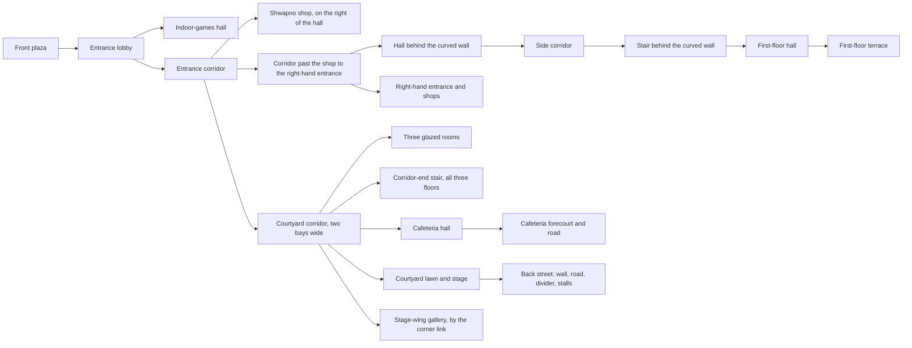
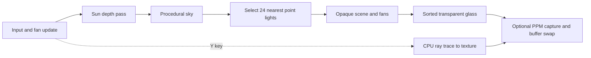
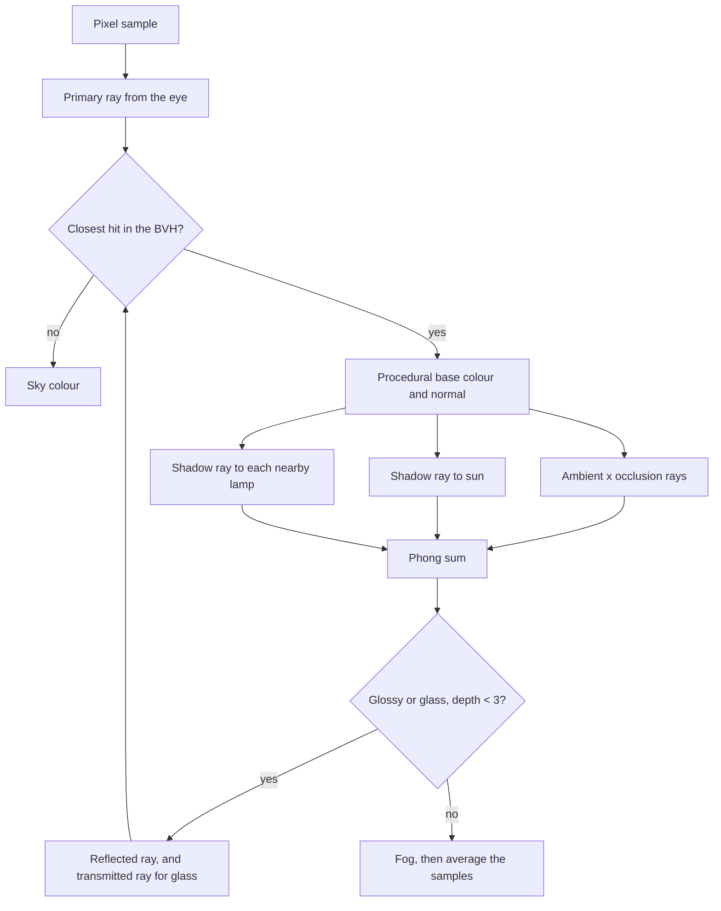

# KUET Student Welfare Centre - Interactive 3D OpenGL Project

A C++17/OpenGL 3.3 architectural visualization of KUET's Student Welfare
Centre (SWC), modeled from 68 reference photographs: 30 exterior views in
`project/`, 14 right-side views in `project_2/` and a 24-photo interior
walkthrough in `project_3/`. The same scene is drawn two ways: a real-time
OpenGL rasteriser with Phong shading and shadow mapping, and a CPU ray tracer
with reflections, exact shadows and ambient occlusion.

Quick links: [Build and run](#build-and-run-powershell) ·
[Controls](#camera-controls) · [Requirements](#requirements-checklist) ·
[Interior walkthrough](#interior-walkthrough-project_3) ·
[Ray tracing](#ray-traced-rendering) · [Folder layout](#folder-layout) ·
[Features and equations](#implemented-features-and-mathematics) ·
[Validation](#validation).


**Main entrance — capture 1.** Boxes, cylinders, curved surfaces, and repeated
components form the building and grounds. Procedural materials supply the brick
and paving detail; directional lighting and shadow mapping give the forms depth.
The images in this README are captures from the application, stored in
`docs/images/` so they remain available independently of the generated `build/` folder.

The layout follows `SWC_Reference.txt`: connected wings of differing heights
around a large courtyard lawn, the deep front portico and long colonnade, the
flared curved brick SWC facade with bands, louvers and bilingual lettering,
the courtyard stage, the cafeteria with its external stair, the plaza alpona,
the bamboo gazebo, roads, hedges and palms. Lighting is per-fragment Phong
with shadow mapping from one consistent sun.

The corrected layout leaves the left side open. Behind the entrance and curved
SWC sign, a covered tiled corridor connects to the three-storey block, with
aligned upper walkways. The stair between the ground and first floors stands
behind the curved SWC wall, reached by a side corridor beside the shop. The central
entrance doorway is open so the route through to the courtyard is visible.
The three-storey block is shifted forward and onto the doorway's centreline:
walking through the main door now continues straight along its corridor.
Its room side extends to the right edge of the oval SWC facade, with additional
front window bays; the corridor alignment stays fixed.
The cafeteria occupies the rear bays beside the gazebo, at a setback of 20
units from the old side entrance. Facing it, the external stair is on the
right and joins a separate two-storey balcony/windowed block. Camera preset
`5` faces the entrance and `V` shows the complete corner.

The 14 additional photographs in `project_2/` guide the right-side shop wing:
a two-storey shop canopy extends back from the curved sign,
with tall free-standing columns, a recessed plain upper wall, open
shops and brick-inset end balconies. Farther back, the cafeteria's right-hand
stair connects to the grilled balcony of its adjoining low block. The roadside
planting, raised tiled arcade, and paved forecourt follow the new views.
Dimensions remain visual estimates from photographs, rather than a survey.

The 24 photographs in `project_3/` add the interior. The ground floor of the
front-left wing is the indoor-games hall, entered from the lobby beside a
terracotta relief wall. The Shwapno shop is on the right of the entrance
hall, its long front parallel to the way in, under a diagonal-rib ceiling. The bays behind the
CAFETERIA sign are a dining hall that runs back along the courtyard corridor
behind a glazed wall, with a stair to all three floors at the corridor's far
end. Beside the courtyard the
ground corridor is two bays wide, and its outer bay carries a first-floor
terrace under deep portal frames. Three further images in the project root
(`corridor-with-stair.png`, `corridor-with-door.png`, `stair-behind-oval.png`)
fix the stair: it stands inside the curved wall, at the end of a side
corridor, and the curved wall itself stands forward of the building to make
room for the stair hall. The 25 photographs in `road/` add the street behind
the SWC: boundary wall, footpath, road, divider and a row of stalls. See
[Interior walkthrough](#interior-walkthrough-project_3) and sections 17-20 of
`SWC_Reference.txt`.

Covered tiled passages connect the compact stall wing, front entrance and
courtyard. Two wide stalls sit left of the grille entrance; its steps and paved
approach lead straight through the room block to the courtyard corridor.
The entrance's open upper balcony, brick parapet, grille and adjacent window
wall follow `project_2/WhatsApp Image 2026-09-29 at 6.42.32 PM.jpeg`.
Press `H` to view the entrance and straight passage.

## Build and run (PowerShell)

```powershell
cd D:\image_project
cmake -S . -B build -G "MinGW Makefiles"
cmake --build build --parallel
.\build\image_project.exe
```

The current executable is `build/image_project.exe`. Close the viewer before
rebuilding so Windows can replace it.

The first CMake configuration downloads GLFW. Later builds normally work
offline. The program opens at a front three-quarter presentation view.
The build defaults to `Release`, which the CPU ray tracer needs; pass
`-DCMAKE_BUILD_TYPE=Debug` to override it.

## Requirements checklist

The project requirements are listed in `src/requirement`. Each one maps to
code and to a section of this document:

| # | Requirement | Where it is met |
|---|---|---|
| 1 | Virtual 3D environment | The SWC site: wings, courtyard, interiors, roads and planting, assembled by [`buildScene()`](src/scene/scene.cpp) |
| 2 | Objects from basic primitives | Nine canonical shapes in [canonical_shapes.h](src/geometry/canonical_shapes.h); see [section 1](#1-basic-objects-and-triangle-meshes) and the `F9` gallery |
| 3 | Translation, rotation, scaling | `translation()`, `rotationX/Y()`, `scaling()` in [geometry_math.h](src/geometry/geometry_math.h); [section 3](#3-translation-rotation-scaling-and-hierarchy) |
| 4 | Composite transformations | `trs()` and the `Place` transform stack; interactive `T R S` on the whole model; fan rotors `M T R` |
| 5 | Custom vector and matrix operations | `Vec3`, `Mat4`, `Mat3`, dot, cross, multiply, inverse-transpose; [section 2](#2-vector-operations-and-surface-normals) |
| 6 | Camera and viewing transformations | Custom `lookAt()`; orbit, pan, walk; 37 presets; [section 4](#4-orbit-camera-look-at-matrix-and-zoom) |
| 7 | Perspective projection | Custom `perspective()` (and `orthographic()`); [section 5](#5-perspective-and-orthographic-projection) |
| 8 | Interactive manipulation | Mouse and keyboard camera, model `J/L`, `Z/X`, `U/O`, `I/K`, shadows `B`, fans `P`, ray trace `Y` |
| 9 | Ambient, diffuse, specular lighting | Sun plus ceiling point lights; [sections 6](#6-per-fragment-phong-illumination) and [13](#13-point-lights-attenuation-and-emissive-surfaces) |
| 10 | Phong model, per-fragment shading | Fragment shader in [shaders.cpp](src/render/shaders.cpp); the ray tracer evaluates the same model per ray |
| 11 | Explore from different viewpoints | Presets, orthographic elevations, collision-aware walking through every modelled interior |

Beyond the requirements: shadow mapping with PCF, procedural materials and
sky, alpha-blended glass, time-based animation, collision detection, and
[ray tracing](#14-ray-tracing) with a bounding-volume hierarchy.

## VS Code include paths

Open `D:\image_project` as the workspace folder. The checked-in
`.vscode/c_cpp_properties.json` configures IntelliSense for the installed
32-bit MinGW compiler at `C:/MinGW/bin/g++.exe`, C++17, and the project/GLFW
headers. CMake generates `build/compile_commands.json` so source files use
their actual build flags; explicit include paths also cover standalone headers.
See the [VS Code IntelliSense documentation](https://code.visualstudio.com/docs/cpp/configure-intellisense).

After a fresh checkout, run the CMake configure command above to fetch GLFW
and generate the compilation database. If stale include errors remain, run
**C/C++: Reset IntelliSense Database** and **Developer: Reload Window** from
the command palette. If you change compiler installations, update
`compilerPath` and `intelliSenseMode` in the configuration accordingly.

## Camera controls

The orbit controls below apply outside walking mode. Press `F6` to switch to
walking, where `WASD` moves the camera and arrow keys change its viewing direction.

| Control | Action |
|---|---|
| `1` - `9` | Reference-photo views (see below) |
| `Shift` + `1` - `9` | Interior views matched to the `project_3` walkthrough and the stair images |
| `Y` | Ray trace the current view (shown until the view moves) |
| `0` | Right-side shops and curved-wall connection |
| `V` | Right-side balcony, external stair, and cafeteria forecourt |
| `H` | Covered corridor behind the oval facade |
| `F1` - `F5` | Orthographic front / back / left / right / top (plan) views |
| `F6` | Enter / leave collision-aware walking mode |
| `F7` / `F8` | Room interior / glass entrance views |
| `F9` | Enter / leave the basic-object gallery |
| `P` | Pause / resume ceiling fans, road traffic and pedestrians |
| `F10` | Traffic on the back road |
| Hold left mouse + drag | Orbit around the view target |
| Hold right mouse + drag | Pan the view target |
| Mouse wheel | Zoom in or out |
| `A` / `D` or Left / Right | Rotate horizontally |
| `W` / `S` or Up / Down | Rotate vertically |
| `Q` / `E` | Zoom out / in |
| `T` / `G` | Walk the target forward / back (hold Shift to go faster) |
| `Page Up` / `Page Down` | Raise / lower the target |
| `R` | Return to the main entrance view |
| `F` | Main entrance view and reset model transform |
| `B` | Toggle shadows |
| `J` / `L` | Rotate the 3D model |
| `Z` / `X` | Scale the 3D model down / up |
| `U` / `O` | Translate the 3D model left / right |
| `I` / `K` | Translate the 3D model away / toward the camera |
| `C` | Reset model translation, rotation, and scale |
| `Esc` | Close the program |

| Key | View | Reference photo |
|---|---|---|
| `1` | Main entrance | 3.08.02 AM |
| `2` | Curved SWC facade | 3.08.02 AM (1) |
| `3` | Front-left colonnade | 3.08.01 AM (1) |
| `4` | Front-right wide view | 3.08.04 AM |
| `5` | Cafeteria entrance | 3.07.55 AM |
| `6` | Courtyard stage | 3.07.59 AM |
| `7` | Open left courtyard lawn | Corrected site layout |
| `8` | Straight view through entrance door into the three-storey corridor | Corrected alignment |
| `9` | Aerial overview | - |
| `0` | Right-side shops | project_2, 6.42.27-6.42.31 PM |
| `V` | Right-side stair and balcony | project_2, 6.42.34 PM |
| `H` | Covered connecting corridor | project_2, 6.42.32 PM |
| `F1` | Front elevation (orthographic) | All photos |
| `F2` | Back elevation (orthographic) | All photos |
| `F3` | Left elevation (orthographic) | All photos |
| `F4` | Right elevation (orthographic) | All photos |
| `F5` | Top view / plan, front at the bottom (orthographic) | All photos |
| `Shift+1` | Entrance lobby | project_3, 6.14.05 PM |
| `Shift+2` | Indoor-games hall | project_3, 6.14.06 PM |
| `Shift+3` | Shwapno shopfront | project_3, 6.14.06 PM (2) |
| `Shift+4` | Cafeteria dining hall | project_3, 6.14.08 PM (2) |
| `Shift+5` | Two-bay ground corridor | project_3, 6.14.11 PM (1) |
| `Shift+6` | First-floor terrace | project_3, 6.14.11 PM (2) |
| `Shift+7` | First-floor hall | project_3, 6.14.13 PM (1) |
| `Shift+8` | Side corridor to the stair | corridor-with-stair.png |
| `Shift+9` | Stair behind the curved wall | stair-behind-oval.png |
| `Shift+0` | Corridor windows into the cafeteria | project_3, 6.14.08 PM (1) |
| `Shift+H` | Corridor-end stair | project, 3.07.57 AM |
| `Shift+V` | Stalls across the back road | road/ |
| `Shift+B` | Boundary wall and gate from the road | road/ |
| `N` | Campus gate on the east road | gate photograph |
| `Shift+N` | Open path from the portico to the curved stair | stair-behind-oval.png |

`image_project.exe --capture <1-37> out.ppm` renders one view in a hidden window
and exits. Capture `10` is the `0` key view; capture `11` is the `V` key view.
Capture `12` is the `H` key view. Captures `13`-`17` are the `F1`-`F5`
orthographic views, `18`-`21` the room and gallery views, and `22`-`34` the
`Shift+1` - `Shift+9`, `Shift+0`, `Shift+H`, `Shift+V` and `Shift+B` views. `--raytrace` takes the same view numbers
(see [Ray-traced rendering](#ray-traced-rendering)). An optional size can
follow the file name:

```powershell
.\build\image_project.exe --capture 13 front.ppm 2200 600   # front elevation
.\build\image_project.exe --capture 17 top.ppm 1600 1600    # top view
```

Rendered front, back, left, right and top views are in `build/views/`, with
all five on one sheet in `build/views/SWC_all_views.png`.

## Scene structure


**Site assembly — capture 9.** This perspective view shows how the separate
building wings, open courtyard, paths, and planting fit together. The scene
modules create these parts in local coordinates, and the transform stack places
them into one shared coordinate system. See [composite transformations](#3-translation-rotation-scaling-and-hierarchy)
for the placement equations.

Reusable canonical base shapes are in `src/geometry/canonical_shapes.h`, with
shared vector/matrix math in `src/geometry/geometry_math.h`. See
[CANONICAL_SHAPES.md](CANONICAL_SHAPES.md) for dimensions, transformations,
copyable usage examples and optional geometry tests. Existing scene helpers
use these bases while preserving the model's original vertex data and view.

`buildScene()` in `src/scene/scene.cpp` assembles the model from reusable components
placed with composite `T * R * S` transforms on a transform stack (`Place`):

- `windowBay`, `acUnit`, `door`, `balconyPanel`, `openFrame`, `stair`
- `windowedWing` (long windowed wings) and `galleryWing` (balcony corridors)
- `curvedBrickFacade`, `frontWing`, `entranceCorridor`, `corridorLinkHall`, `northStairwell`,
  `courtyard`, `stage`, `rightSideWing`, `frontGapCorridor`, `cafeteria`, `cafeteriaRightBlock`
- `entranceLobby`, `gamesHall`, `shopHall`, `ovalStairHall`, `cafeteriaHall`, `courtyardTerrace`,
  `upperHall`, `corridorDetails`, `interiorLighting`
- `broadleafTree`, `coconutPalm`, `fanPalm`, `arecaPalm`, `araucaria`,
  `shrub`, `croton`, `hedge`, `gazebo`, `alpona`

Wing lengths, bay counts, storey heights and the curved wall's radius, arc,
flare and heights are parameters, so they can be refined against the photos.

## Folder layout

```text
image_project/
|-- CMakeLists.txt
|-- include/gl_loader.h
|-- include/room_navigation.h
|-- include/walk_navigation.h
|-- src/geometry/canonical_shapes.h
|-- src/geometry/geometry_math.h
|-- src/gl_loader.c
|-- src/main.cpp         entry point only
|-- src/app/             command-line options and application startup
|-- src/geometry/        mesh primitives and transform stack
|-- src/scene/           materials, layout, buildings, interiors, rooms, landscape, scene assembly
|-- src/input/           camera presets, keyboard and mouse controls
|-- src/navigation/      scene collision setup and walk-route checks
|-- src/render/          OpenGL rendering, shaders, CPU ray tracer and screenshot output
|-- tests/               geometry and navigation tests
|-- docs/images/         project screenshots used in this README
|-- project/             30 reference photographs (exterior and courtyard)
|-- project_2/           14 additional right-side photographs
|-- project_3/           24 interior walkthrough photographs
|-- SWC_Reference.txt    written description of all 68 photographs
`-- build/               generated files and executable
```

Most modules have a `.h` interface and a separately compiled `.cpp` implementation.
The canonical shape generators and geometry math are header-only utilities.
`src/scene/layout.h` owns the shared building dimensions. Within `src/scene/`,
`front.cpp`, `courtyard.cpp`, and `exterior.cpp` build the architectural sections;
`components.cpp` supplies reusable building parts, `lettering.cpp` builds signs,
`site.cpp` builds the grounds, `landscape.cpp` places vegetation and the gazebo,
`interior.cpp` builds the halls, terrace and fittings from the `project_3`
walkthrough and registers the ceiling lights, and `rooms.cpp` and
`base_objects.cpp` build the furnished rooms and the object gallery.
`scene.cpp` keeps their assembly order. In `src/render/`, `renderer.cpp` is
the OpenGL frame loop and `raytracer.cpp` is the CPU ray tracer; both read the
same mesh, lights and camera.

## Everyday workflow

1. Edit the relevant module under `src/`; scene assembly starts in `src/scene/scene.cpp`.
2. Run `cmake --build build --parallel`.
3. Run `.\build\image_project.exe`.

The photographs remain in `project/`, `project_2/` and `project_3/` for visual
comparison. They are reference inputs; the executable does not load them.

## Interior walkthrough (project_3)


**Photograph (left of each pair) and model (right).** The interior views use
camera presets `Shift+1` - `Shift+9`, placed where each photograph was taken.

The interior follows the walk recorded in `project_3/`: in at the main
entrance, along the ground floor, up the stair, around the first floor, and
out on the right-hand side. The stair position follows the three images in
the project root rather than the walkthrough.

| Space | Photograph | What is modelled | Function |
|---|---|---|---|
| Entrance lobby | 6.14.05 PM, 3.08.03 AM | 4.35 m terracotta relief wall facing the plaza, recessed 2.6 m behind a blank white bay; white side wall at a right angle to it with the INDOOR GAMES door near the corner; tournament board; yellow strip | `entranceLobby()`, `gamesHall()` |
| Indoor-games hall | 6.14.06 PM | Hollow ground floor of the front-left wing: entered by the side door from the lobby; window bays on both long walls, columns, table-tennis tables, stacked chairs beside the door, desk, four fans | `gamesHall()` |
| Shwapno shop | 6.14.06 PM (1), (2) | On the right of the entrance hall, front parallel to the way in: 9 m red fascia with a star panel and lettering, three glazed bays and an open doorway, shelving, gondola, sale stand, bill counter; diagonal ribs over the hall | `shopHall()` |
| Cafeteria hall | 6.14.08 PM (2), 6.14.08 PM (1), 6.14.09 PM | L-shaped dining hall from the CAFETERIA sign back to the glazed rooms: column grid, beams, 24 table sets, counter and menu band, 14 fans. Its corridor wall is glazed (brick panel, barred window, transom, top light), so the tables are seen from the corridor | `cafeteriaHall()` |
| Corridor-end stair | 3.07.57 AM, 6.14.10 PM (1) | Dog-leg stair at the far end of the courtyard corridor, two flights per storey to all three floors, tall landing window | `northStairwell()` |
| Back street | road/ (25 photographs) | Boundary wall of white piers and brick panels with a lattice gate, footpath, a road with a low concrete divider down its middle, the road and stalls continue past the campus gate, with the divider left open opposite it; a row of tin-roofed stalls with lit signboards and stocked shelves, town buildings behind. Where the east campus road meets the wall: the campus gate, with globe lamps on its piers, two stainless leaves of diagonal bars carrying notice boards, a walking gap and brick steps | `backStreet()` |
| Road traffic | easybike and cycle-van reference images | Moving easybikes (red body, windscreen, canopy on posts, white wheel covers, driver), cycle-vans (bicycle front, steel flatbed with cargo, rider) and a bus that passes now and then | `buildVehicleMeshes()`, `vehicleTransform()` |
| People | user direction | Low-polygon pedestrians in five shirt colours walking fixed routes inside and outside the building | `buildPeopleMeshes()`, `collectMovers()` |
| Side corridor and stair | corridor-with-stair.png, stair-behind-oval.png | Corridor from the hall behind the curved wall, with a roller shutter and a high window band; an open path from the entrance portico; one curved flight of 20 steps sweeping round the inside of the curved wall behind a solid white balustrade; a first-floor bridge; white curved lining; tall window; steel rails | `ovalStairHall()` |
| Former stair bay | 6.14.06 PM (1) | Ground floor is part of the Shwapno shop; the first floor joins the gallery to the upper hall | `corridorLinkHall()` |
| Ground corridors | 6.14.07 - 6.14.11 PM | Two-bay corridor, black edge strip, accent tile groups | `courtyardTerrace()`, `corridorDetails()` |
| Corner link | user direction | Paved link at ground level and a bridge at the upper level joining the three-storey block and its terrace to the stage-wing gallery, with a parapet on the courtyard side; the stage wing is 0.15 lower upstairs, one shallow step | `wingLink()` |
| First-floor terrace | 6.14.11 PM, (2), 6.14.12 PM | Terrace over the outer corridor bay, portal frames, brick-inset parapet with rail, planters, blue bench | `courtyardTerrace()` |
| First-floor hall | 6.14.13 PM, (1), (2) | Open upper hall beside the entrance corridor: white west wall with two timber double doors with louvred heads, a room label and a mat; the door wall runs on past its old corner so the hall is wider, and the two corner pillars are left out at this level (`hallColumns` in `galleryWing`); tandem seats and a waste bin stand against the wall; beyond it the hall is open to the courtyard behind a railed parapet; accent tiles | `upperHall()` |


**First-floor terrace - capture 27 / Shift+6.** Each portal frame is two boxes:
a column on the outer line and a beam back to the building. Parapet panels are
the same `balconyPanel` component used on the galleries, placed with a
`T * R_y(-90 deg)` transform so they face the lawn.


**Cafeteria hall - capture 25 / Shift+4.** One `diningSet()` (a table and four
chairs, 38 boxes) is repeated 24 times. All 14 fan rotors are instances of
a single rotor mesh. The room is lit by the point lights of
[section 13](#13-point-lights-attenuation-and-emissive-surfaces).

| | |
|---|---|
|  Lobby - capture 22 |  Games hall - capture 23 |
|  Shop hall - capture 24 |  Ground corridor - capture 26 |
|  First-floor hall - capture 28 |  Curved stair, from the first-floor bridge - capture 30 |
|  Open path into the stair hall - capture 36 | |
|  Corridor windows into the cafeteria - capture 31 |  Corridor-end stair - capture 32 |
|  Stalls across the back road - capture 33 |  Boundary wall and road - capture 34 |
|  Campus gate, seen from the street - capture 35 / `N` | |
|  Easybike |  Cycle-van |
|  Bus on the back road - capture 37 / `F10` | |
|  Side corridor to the stair - capture 29 |  Stair hall, ray traced - capture 30 |

How the spaces connect (all of it walkable with `F6`):



### Stair behind the curved wall


**Reference (left of each pair) and model (right): `corridor-with-stair.png`
with capture 29, and `stair-behind-oval.png` with a ray trace of capture 30.**

The stair was moved from beside the entrance axis to the space between the
building and the curved brick wall:

- **Curved wall.** Its centre is at $(c_x,c_z)=(15,-3.5)$, one metre forward
  of its first position, so the space between it and the building is deep
  enough for the stair and the approach to it.
- **Side corridor.** A 3.2 m wide corridor ($14.6\le x\le17.8$) runs 5 m from
  the hall behind the curved wall toward the stair. One wall carries a roller
  shutter; the other a high band of barred windows.
- **Stair hall.** The corridor opens into a double-height hall bounded by the
  inside of the curved wall. With inner radius $r=7.06$, the wall is at

$$
z(x)=c_z+\sqrt{r^2-(x-c_x)^2},
$$

  and the floor, the landing, the roof and the white lining all end on that
  line. The floor is a triangle fan from the corridor mouth to 32 points on
  the arc. The end wall beside the portico has a large glass pane, so the
  lobby is seen from the stair hall as in 6.14.15 PM.
- **Open path.** The end wall of the stair hall beside the portico is open,
  so the hall is entered straight from the entrance lobby as well as from
  the side corridor.
- **Curved flight.** One flight of 20 risers ($h_r=3.6/20=0.18$) sweeps round
  the inside of the curved wall between radii $r_{\mathrm{in}}=5.56$ and
  $r_{\mathrm{out}}=7.02$. Each step is a sector of angle
  $\Delta\theta=d_t/r_{\mathrm{mid}}$ with tread $d_t=0.28$ measured on the
  mid radius $r_{\mathrm{mid}}=6.29$, so step $i=0,\ldots,19$ spans

$$
\theta_i=\theta_0+i\,\Delta\theta,\qquad
\mathbf p(\theta,r)=\left(c_x+r\sin\theta,\;0.45+(i+1)h_r,\;c_z+r\cos\theta\right),
\qquad r_{\mathrm{in}}\le r\le r_{\mathrm{out}}.
$$

  The whole flight turns through $20\,\Delta\theta\approx51^\circ$. A solid white
  balustrade 0.95 high follows the inner radius and rises with the steps; it
  is the sweeping curved wall of `stair-behind-oval.png`.
- **Bridge.** The flight arrives on a first-floor bridge ($y=4.05$) that
  crosses the hall from the curved wall to the walkway above the side corridor.
- **Shop.** Shwapno is not behind the curved wall. It stands on the right of
  the entrance hall ($3.5\le x\le7.4$, $-16.4\le z\le-7.4$), where the stair
  bay and the hall's west end used to be.

Where the model departs from the photographs:

- The side corridor is 5 m long before the stair; the reference shows a much
  longer one.
- The shop is 3.65 m deep. The photographs show a deeper shop with more aisles.
- The curved balustrade is built from 20 flat segments that step up with the
  treads; the reference shows one smooth sloping wall.
- The landing window is a bright panel on the inside of the curved wall; the
  brick outside is unchanged and has no matching opening.
- This stair joins the ground and first floors only. The second floor is
  reached by the corridor-end stair, which the photographs 3.07.57 AM and
  6.14.10 PM (1) show.

- The lobby's terracotta wall is 4.35 m wide and 5.55 m tall. It replaces the
  first leaf of the timber entrance, so the doorway is three leaves wide.
- The white side wall with the INDOOR GAMES door is 3 m long in the model;
  the photograph shows a longer wall.
- The cafeteria's glazed corridor wall has four window modules; the
  photographs suggest more, of slightly different widths.
- The back street is placed behind (north of) the building from the
  description given with the road/ photographs. Stall sizes, colours and
  the buildings behind them are generated, not copied shop by shop.
- The first-floor hall is the 4.6 m wide upper entrance corridor and the
  corridor junction beside it. The photographs show a broader, deeper room.
- Window glazing seen from inside the halls is a bright emissive panel, not
  a hole in the wall, so no sunlight enters through it.
- The Bengali shop lettering is generated strokes, as on the exterior signs.
- Hall depths, column counts and furniture counts are estimated from single
  photographs. People, posters, banners and vehicles are left out.

## Ray-traced rendering


**Same scene, same camera: OpenGL rasteriser (left) and CPU ray tracer
(right).** The ray tracer adds what the photographs show and Phong shading
cannot: the polished floor mirrors the windows and furniture, every table
casts a shadow from every lamp, and corners darken where surfaces meet.

Press `Y` in the viewer to ray trace the current view at the window's size
(one sample per pixel, three occlusion rays; a 640 x 480 window takes about
two seconds, during which the window does not respond). The image replaces
the live view until the camera or model moves. From the command line:

```powershell
.\build\image_project.exe --raytrace 25 cafeteria.ppm              # 960 x 600, 4 samples
.\build\image_project.exe --raytrace 25 cafeteria.ppm 1000 750 9   # size and samples per pixel
```

`--raytrace` needs no window or graphics driver. On the development machine a
1000 x 750 frame at 9 samples per pixel takes about half a minute, using
one thread per processor. The scene is about 335,000 triangles in a hierarchy
of about 231,000 nodes, lit by the sun and 106 point lights.

| | |
|---|---|
|  Shop hall: floor reflections of the lit sign; the glazing transmits and reflects |  Terrace: sun shadows of the portal frames |
|  Corridor beside the cafeteria: the glazing transmits the dining hall and reflects the corridor |  Main entrance: exact sun shadows under the canopy |

The method and its equations are in [section 14](#14-ray-tracing).

## Walk-through rooms


**Interior geometry — capture 19 / F7.** The room combines box-based furniture,
window frames, and cylindrical fan parts. The fan mount stays fixed while the
rotor receives its own animated transform. Walking collision uses the static
room geometry; see [fan animation](#10-time-based-ceiling-fan-animation) and
[walking and collision](#11-walking-collision-detection-and-stairs) for the equations.

Three furnished rooms open onto the straight connecting corridor. Each has a
parked-open sliding door, transparent Thai-style aluminium-framed glazing and
a rotating ceiling fan. These interiors are illustrative additions.

Run `.\build\image_project.exe`, then press **F6** to walk around the SWC.
Walking starts at the current view when it is on an accessible floor; aerial
and gallery views start at the front plaza instead.
Use **WASD** to walk and **arrow keys** or **left-mouse drag** to look around.
Hold **Shift** to walk faster.
Walls, glass and furniture stop movement; enter through the central opening.
**F6** or **R** returns to the main exterior view. Walk across the grounds,
through the open entrance into the courtyard and connecting corridors, and
through the glass doorways into the three furnished rooms. Steps change your
eye height automatically; walls, closed doors, glass, railings and low ceilings
block movement. Only existing open interiors are accessible: solid building
masses are not furnished rooms.

**F7** shows a room and fan; **F8** looks back through the glass entrance.
**P** pauses/resumes all fans. Existing exterior and orthographic presets remain
available outside walking mode. Capture views **18**, **19**, **20** are the
corridor, room interior and glass entrance; captures use a fixed fan angle.

Reusable `room`, `thaiGlassPanel` and `ceilingFan` functions are in
`src/scene/rooms.cpp`. Room dimensions and fan transforms are in `include/room_navigation.h`.
`include/walk_navigation.h` indexes the rendered scene triangles for body
clearance, floor support, wall sliding and stair movement. Fan rotors reuse one mesh with animated transforms;
glass is blended after opaque geometry. Build with `SWC_BUILD_TESTS=ON` and run
`ctest --test-dir build --output-on-failure` to check geometry, movement and complete SWC routes.
`image_project.exe --check-walk` runs the scene route checks without a window.

## Base object gallery


**Basic geometry — capture 21 / F9.** Each displayed object starts from the
canonical generators in `src/geometry/canonical_shapes.h`. The gallery places
and scales them on individual bases, demonstrating how simple triangle meshes
can be reused throughout the larger model. Their construction equations appear
under [basic objects and triangle meshes](#1-basic-objects-and-triangle-meshes).

Press **F9** to inspect the cube, cylinder, sphere, cone, frustum, open tube,
ring, plane and triangle in a separate labelled gallery. Use **A/D** to orbit,
**W/S** to tilt, and **Q/E** to zoom (mouse drag and wheel also work).
Press **F9** again or **R** to return to the building. Capture view **21** exports
the gallery. `buildBaseObjectGallery()` demonstrates the canonical generators
with placement and scaling; the SWC geometry stays in its own draw range.

## Courtyard reference view


**Repeated architectural components — capture 6.** The window and balcony bays
repeat reusable geometry across the facade. The lawn, brick, and daylight sky
use procedural shading, while the stage and surrounding building cast shadows.
This view connects the [material equations](#8-procedural-materials-sky-and-fog)
with the [lighting](#6-per-fragment-phong-illumination) and
[shadow calculations](#7-shadow-mapping-and-filtering).

Press **6** for the courtyard and stage matched to
`project/WhatsApp Image 2026-09-26 at 3.07.59 AM.jpeg`.
The north wing has four projecting framed bays and three open balcony bays,
a wider footprint, recessed brick panels, narrow ground-floor windows and a
low, shallow curved stage. The lawn is kept open in front of the stage.
The daylight sky and lawn use procedural shading; no external textures are needed.
Dimensions are estimated from the photograph rather than surveyed measurements.

For a preview in the photograph's 4:3 aspect ratio:

```powershell
.\build\image_project.exe --capture 6 build/stage-reference.ppm 1200 900
```

## Implemented features and mathematics

The equations below describe the current implementation. Positions use approximate
metres, with **+Y upward**, **+X to the right when facing the entrance**, and
**+Z toward the front plaza**. Angles in equations are radians unless marked as
degrees. Matrices below multiply column vectors; the C++ arrays store matrices
in column-major order. The application builds its own geometry and math rather
than loading a finished 3D model.

| Feature | Purpose in this project | Implementation |
|---|---|---|
| Basic geometric objects | Construct buildings, furniture, trees, and the F9 gallery | [canonical_shapes.h](src/geometry/canonical_shapes.h), [mesh.cpp](src/geometry/mesh.cpp) |
| Vector and matrix operations | Calculate positions, directions, normals, and projections | [geometry_math.h](src/geometry/geometry_math.h) |
| Composite transformations | Place, rotate, and scale reusable objects and the complete model | [mesh.h](src/geometry/mesh.h), [renderer.cpp](src/render/renderer.cpp) |
| Reusable scene components | Assemble windows, corridors, wings, rooms, and landscaping | [scene.cpp](src/scene/scene.cpp), [components.cpp](src/scene/components.cpp) |
| Camera and projections | Orbit, pan, zoom, walk, and inspect elevations | [camera.cpp](src/input/camera.cpp), [geometry_math.h](src/geometry/geometry_math.h) |
| Phong illumination | Shade surfaces using ambient, diffuse, and specular terms | [shaders.cpp](src/render/shaders.cpp) |
| Point lights and emission | Light covered spaces from ceiling fixtures; glowing glazing, battens and signs | [interior.cpp](src/scene/interior.cpp), [shaders.cpp](src/render/shaders.cpp) |
| Ray tracing | Reflections, exact shadows, glass transmission, ambient occlusion, supersampling | [raytracer.cpp](src/render/raytracer.cpp) |
| Shadow mapping | Cast building, tree, and animated fan shadows | [renderer.cpp](src/render/renderer.cpp), [shaders.cpp](src/render/shaders.cpp) |
| Procedural surfaces and sky | Produce brick, paving, grass, thatch, and clouds without image textures | [materials.cpp](src/scene/materials.cpp), [shaders.cpp](src/render/shaders.cpp) |
| Transparent glass | Show room interiors through glazing | [rooms.cpp](src/scene/rooms.cpp), [renderer.cpp](src/render/renderer.cpp) |
| Animation | Rotate all 21 ceiling fans using elapsed time | [rooms.cpp](src/scene/rooms.cpp), [renderer.cpp](src/render/renderer.cpp) |
| Moving traffic | Easybikes, cycle-vans and an occasional bus drive along the back road | [street.cpp](src/scene/street.cpp), [renderer.cpp](src/render/renderer.cpp) |
| Pedestrians | 35 people walk fixed routes inside and outside the SWC | [people.cpp](src/scene/people.cpp), [renderer.cpp](src/render/renderer.cpp) |
| Collision and stairs | Keep the walking camera on floors and out of solid geometry | [walk_navigation.h](include/walk_navigation.h), [navigation.cpp](src/navigation/navigation.cpp) |
| GPU rendering and capture | Draw triangle meshes, test depth, and export PPM images | [renderer.cpp](src/render/renderer.cpp), [screenshot.cpp](src/render/screenshot.cpp) |

### 1. Basic objects and triangle meshes

`canonical_shapes.h` defines reusable objects around a standard origin. The
functions in `mesh.cpp` turn them into positioned scene geometry. Each vertex
stores a position, normal, colour, gloss value, and procedural-pattern identifier.
Three consecutive vertices form a triangle; a quad becomes two triangles:

$$
(A,B,C,D)\longrightarrow(A,B,C),\;(A,C,D).
$$

**Cube and box.** The canonical cube has coordinates between $-0.5$ and $0.5$
on each axis. A box with centre $(c_x,c_y,c_z)$ and dimensions $(w,h,d)$ uses:

$$
x=c_x\pm\frac{w}{2},\qquad
y=c_y\pm\frac{h}{2},\qquad
z=c_z\pm\frac{d}{2}.
$$

Six faces give twelve triangles. Boxes form walls, floors, beams, doors, and furniture.

**Cylinder and open tube.** Circular geometry samples angles
$\theta_i=2\pi i/N$, where $N$ is the number of segments. An elliptical cylinder uses:

$$
\mathbf p(\theta,y)=
\begin{bmatrix}c_x+r_x\cos\theta\\y\\c_z+r_z\sin\theta\end{bmatrix},
\qquad y\in[c_y-h/2,c_y+h/2].
$$

The canonical cylinder has radius 1, height 1, and both end caps. The canonical
tube has radius 1, runs from $y=0$ to $y=1$, and has no caps. Cylindrical forms
are used for columns, poles, fan parts, and vegetation.

**Cone and frustum.** Radius varies linearly with height:

$$
r(t)=(1-t)r_0+tr_1,\qquad
\mathbf p(\theta,t)=\mathbf b+
\begin{bmatrix}r(t)\cos\theta\\ht\\r(t)\sin\theta\end{bmatrix},
\quad 0\le t\le1.
$$

Here $\mathbf b$ is the base centre, $h$ is height, and $r_0,r_1$ are bottom
and top radii. A cone uses $r_1=0$. The side normal is proportional to
$(\cos\theta,(r_0-r_1)/h,\sin\theta)$. The canonical generator supports caps;
the scene's `frustum()` adapter preserves its open bottom and top cap.

**Sphere and ellipsoid.** With latitude $\phi$ and longitude $\theta$:

$$
\mathbf p(\phi,\theta)=\mathbf c+r
\begin{bmatrix}
\cos\phi\cos\theta\\\sin\phi\\\cos\phi\sin\theta
\end{bmatrix},
\qquad -\pi/2\le\phi\le\pi/2,\quad 0\le\theta<2\pi.
$$

Latitude/longitude cells are triangulated. Scaling the three coordinates by
different radii produces an ellipsoid, used for foliage and rounded forms.

**Ring, plane, and triangle.** An annulus lies in the XZ plane:

$$
\mathbf p(r,\theta)=(c_x+r\cos\theta,\;c_y,\;c_z+r\sin\theta),
\qquad r_{\mathrm{inner}}\le r\le r_{\mathrm{outer}}.
$$

Angular sectors form the ring; limiting the angle produces an arc. The canonical
plane is a unit square at $y=0$, and the canonical triangle has vertices
$(0,0,0)$, $(1,0,0)$, and $(0,1,0)$. These nine object types are demonstrated
in [base_objects.cpp](src/scene/base_objects.cpp), available with `F9`.

**Stairs and repeated components.** `stair()` builds each tread as a box. For
step index $i=0,\ldots,N-1$, riser height $h_r$, tread depth $d_t$, and front
coordinate $z_f$, its top and depth interval are:

$$
y_i=y_{\mathrm{base}}+(i+1)h_r,\qquad
z\in[z_f-(i+1)d_t,\;z_f-id_t].
$$

Repeated windows, columns, and floor levels use loops and local transforms.
[lettering.cpp](src/scene/lettering.cpp) builds signs from 5-by-5 block glyphs;
the Bengali line uses stylized generated strokes rather than a font renderer.
[site.cpp](src/scene/site.cpp) combines rings and petal geometry for the plaza artwork.

### 2. Vector operations and surface normals

For vectors $\mathbf a$ and $\mathbf b$, the custom math library implements:

$$
\mathbf a\cdot\mathbf b=a_xb_x+a_yb_y+a_zb_z,\qquad
\|\mathbf a\|=\sqrt{\mathbf a\cdot\mathbf a},\qquad
\hat{\mathbf a}=\frac{\mathbf a}{\|\mathbf a\|}.
$$

$$
\mathbf a\times\mathbf b=
\begin{bmatrix}a_yb_z-a_zb_y\\a_zb_x-a_xb_z\\a_xb_y-a_yb_x\end{bmatrix},
\qquad
\mathbf n=\operatorname{normalize}((B-A)\times(C-A)).
$$

The dot product measures directional alignment for lighting; the cross product
constructs face normals and camera axes. `normalize()` returns $(0,1,0)$ when
the input length is too small to divide safely. Smooth shapes supply their own
per-vertex normals rather than a single flat normal per triangle.

Matrix multiplication is implemented directly with three nested loops:

$$
(AB)_{ij}=\sum_{k=0}^{3}A_{ik}B_{kj},\qquad i,j\in\{0,1,2,3\}.
$$

### 3. Translation, rotation, scaling, and hierarchy

A point is represented in homogeneous coordinates as $\mathbf p=(x,y,z,1)^T$.
The project uses these translation, Y-rotation, and scale matrices:

$$
T=\begin{bmatrix}1&0&0&t_x\\0&1&0&t_y\\0&0&1&t_z\\0&0&0&1\end{bmatrix},
\quad
R_y(\theta)=\begin{bmatrix}
\cos\theta&0&\sin\theta&0\\0&1&0&0\\-\sin\theta&0&\cos\theta&0\\0&0&0&1
\end{bmatrix},
\quad
S=\begin{bmatrix}s_x&0&0&0\\0&s_y&0&0\\0&0&s_z&0\\0&0&0&1\end{bmatrix}.
$$

`rotationX()` also rotates geometry around X:

$$
R_x(\theta)=\begin{bmatrix}
1&0&0&0\\0&\cos\theta&-\sin\theta&0\\0&\sin\theta&\cos\theta&0\\0&0&0&1
\end{bmatrix}.
$$

`trs()` combines transformations as:

$$
M_{\mathrm{local}}=TR_yS,\qquad
M_{\mathrm{child}}=M_{\mathrm{parent}}M_{\mathrm{local}}.
$$

The rightmost operation happens first: scale, rotate, then translate. `Place`
pushes the child transform onto a stack and restores the parent when its scope
ends. A window can therefore be built in local coordinates and placed on a
rotated building wing. These placement transforms are baked into mesh vertices;
the renderer applies a separate interactive model transform to the assembled scene.

Non-uniform scaling requires an inverse-transpose normal matrix. For the upper
left $3\times3$ part $A$ of a model transform:

$$
\mathbf n'=\operatorname{normalize}\left((A^{-1})^T\mathbf n\right).
$$

This keeps lighting normals perpendicular to surfaces after scaling.

### 4. Orbit camera, look-at matrix, and zoom

The orbit camera uses target $\mathbf c$, distance $d$, yaw $\psi$, and pitch
$\phi$. Its eye position is:

$$
\mathbf e=\mathbf c+d
\begin{bmatrix}\cos\phi\sin\psi\\\sin\phi\\\cos\phi\cos\psi\end{bmatrix}.
$$

`lookAt()` builds a camera basis from a supplied up direction $\mathbf u_0$:

$$
\mathbf f=\operatorname{normalize}(\mathbf c-\mathbf e),\quad
\mathbf s=\operatorname{normalize}(\mathbf f\times\mathbf u_0),\quad
\mathbf u=\mathbf s\times\mathbf f.
$$

$$
V=\begin{bmatrix}
s_x&s_y&s_z&-\mathbf s\cdot\mathbf e\\
u_x&u_y&u_z&-\mathbf u\cdot\mathbf e\\
-f_x&-f_y&-f_z&\mathbf f\cdot\mathbf e\\
0&0&0&1
\end{bmatrix}.
$$

Dragging changes yaw/pitch; panning moves the target along camera-relative
horizontal directions. A mouse-wheel offset $\delta$ updates zoom using
$d'=\operatorname{clamp}(d\,0.9^{\delta},0.5,160)$.
Preset views select the eye, target, field of view, and optional orthographic size.

### 5. Perspective and orthographic projection


**Plan projection — capture 17 / F5.** The camera looks straight down, with the
front of the site at the bottom. Orthographic projection keeps the scale
independent of camera depth, making the arrangement easier to inspect. Compare
this with the aerial perspective image in [Scene structure](#scene-structure),
where distance affects apparent size. The two views use different camera poses.

For vertical field of view $\alpha$, aspect ratio $a$, near distance $n$, far
distance $f$, and $q=1/\tan(\alpha/2)$, perspective projection is:

$$
P=\begin{bmatrix}
q/a&0&0&0\\0&q&0&0\\
0&0&-(f+n)/(f-n)&-2fn/(f-n)\\0&0&-1&0
\end{bmatrix}.
$$

Objects appear smaller with distance after the perspective division. Elevation
and plan views use orthographic bounds $l,r,b,t$ instead:

$$
P_{\mathrm{ortho}}=\begin{bmatrix}
2/(r-l)&0&0&-(r+l)/(r-l)\\
0&2/(t-b)&0&-(t+b)/(t-b)\\
0&0&-2/(f-n)&-(f+n)/(f-n)\\
0&0&0&1
\end{bmatrix}.
$$

The complete camera transform is:

$$
\mathbf p_{\mathrm{clip}}=PVM\mathbf p,\qquad
\mathbf p_{\mathrm{ndc}}=
\frac{(p_{\mathrm{clip},x},p_{\mathrm{clip},y},p_{\mathrm{clip},z})}
{p_{\mathrm{clip},w}}.
$$

Here $M$ is the interactive model transform applied to the already assembled
mesh. The camera uses near/far distances of 0.15 and 450. The sun's shadow
camera uses its own orthographic projection.

### 6. Per-fragment Phong illumination

The fragment shader normalizes interpolated normals and computes lighting per
pixel. Let $\mathbf n$ be the surface normal, $\mathbf l$ the normalized direction
toward the sun, $\mathbf v$ the direction toward the eye, $g$ the material gloss,
and $S_h$ the shadow visibility between 0 and 1. The shader uses:

$$
D=\max(\mathbf n\cdot\mathbf l,0)S_h,\qquad
\mathbf r=2(\mathbf n\cdot\mathbf l)\mathbf n-\mathbf l,
$$

$$
k=8+88g,\qquad
H=\max(\mathbf v\cdot\mathbf r,0)^k\,gS_h.
$$

The ambient colour blends ground bounce and sky illumination based on normal Y:

$$
\mathbf A=0.62\operatorname{mix}
(\mathbf C_{\mathrm{ground}},\mathbf C_{\mathrm{sky}},0.5n_y+0.5).
$$

For ordinary materials, the colour before glass, fog, and highlight adjustments is:

$$
\mathbf C=\mathbf C_{\mathrm{base}}\odot
(\mathbf A+0.95\mathbf C_{\mathrm{sun}}D+\mathbf L_d)
+0.6\mathbf C_{\mathrm{sun}}H+0.5g\,\mathbf L_s.
$$

$\odot$ means component-wise colour multiplication. Higher gloss produces a
narrower, stronger highlight. $\mathbf L_d$ and $\mathbf L_s$ are the diffuse
and specular sums over the ceiling point lights, defined in
[section 13](#13-point-lights-attenuation-and-emissive-surfaces). Interior
materials replace the sky/ground ambient blend with a neutral
$\mathbf A=(0.44,0.44,0.42)$, because indoor surfaces receive bounced light
from white walls, not blue sky. Normals facing away from the viewer are
flipped for two-sided leaves, glass, and thin panels.

### 7. Shadow mapping and filtering

The renderer first draws a depth map from the sun's viewpoint, at **4096 x 4096**.
For a world-space surface point $\mathbf p$, the receiving shader offsets along
the transformed vertex normal and projects into light space:

$$
\mathbf p_L=P_LV_L
\begin{bmatrix}\mathbf p+0.05\hat{\mathbf n}\\1\end{bmatrix},\qquad
\mathbf q=0.5\frac{\mathbf p_{L,xyz}}{p_{L,w}}+0.5.
$$

The depth comparison uses a slope-dependent bias to reduce self-shadow artifacts:

$$
\beta=0.0006+0.0012\left(1-\max(\mathbf n\cdot\mathbf l,0)\right).
$$

Nine neighbouring samples produce a 3-by-3 percentage-closer filter (PCF):

$$
S_h=\frac{1}{9}\sum_{i=-1}^{1}\sum_{j=-1}^{1}
\mathbf 1\left[q_z-\beta\le
D_{\mathrm{map}}(q_x+i/4096,q_y+j/4096)\right].
$$

$\mathbf 1$ is 1 when the comparison is true and 0 otherwise. Averaging softens
shadow edges. `B` toggles shadows in orbit mode; fan geometry participates in
both the shadow pass and the visible pass.

### 8. Procedural materials, sky, and fog

Surface colours come from world-position calculations, not external texture
images. Brick, paving, and tiles use repeated cells; alternating brick rows shift
by half a unit:

$$
j=\lfloor v/h\rfloor,\qquad
\mathbf c=\left(u/w+0.5(j\bmod2),\;v/h\right).
$$

Here $w,h$ are a unit's width/height and $(u,v)$ are surface coordinates. The
fractional part of $\mathbf c$ locates mortar edges. Floor tiles use the same
idea without the row shift, giving a straight 0.6 m grid:
$\mathbf c=(x/0.6,\;z/0.6)$. The black and grey accent tiles are thin boxes
snapped to that grid with $x_g=0.6\lfloor x/0.6\rfloor$, so their edges land
on the joints. Hashed cell values vary
colour, while screen-space derivatives fade fine patterns when they become
too small to display clearly.

Value noise interpolates four hashed grid corners using the smooth weight:

$$
w(t)=t^2(3-2t),\qquad
\operatorname{mix}(A,B,t)=(1-t)A+tB.
$$

Noise at different scales supplies grass patches, blades, natural surfaces,
and thatch. The CPU also uses deterministic `hash1()` values to vary vegetation
and window materials without changing the arrangement on every frame.

The sky shader constructs a view ray from screen coordinates $(s_x,s_y)$:

$$
\mathbf d=\operatorname{normalize}\left(
\mathbf f+\mathbf s\,s_xa\tan(\alpha/2)
+\mathbf u\,s_y\tan(\alpha/2)\right).
$$

It blends horizon and upper-sky colours by ray elevation. Cloud density combines
five noise layers, with $\mathbf p_0$ the projected sky coordinate:

$$
C_{\mathrm{cloud}}=\sum_{i=0}^{4}0.55(0.48)^iN(\mathbf p_i),\qquad
\mathbf p_{i+1}=2.03\mathbf p_i+(3.7,1.8).
$$

Distance fog blends surface colour toward a pale blue fog colour:

$$
F=1-e^{-0.006\max(d-45,0)},\qquad
\mathbf C_{\mathrm{fogged}}=(1-0.65F)\mathbf C+0.65F\mathbf C_{\mathrm{fog}}.
$$

Here $d$ is the eye-to-surface distance. Orthographic views also soften colour
components above 0.78 using $0.78+0.22(1-e^{-(c-0.78)/0.22})$ before fog is applied.

### 9. Glass transparency and reflection approximation


**Transparent glazing — capture 20 / F8.** The glass is drawn after opaque
objects so the scene behind it contributes to the final colour. The metal
frames remain opaque. The equations below explain the alpha blend and the
view-dependent sky/ground reflection approximation used for the panes.

Room, shop, stair-hall and cafeteria-corridor glass uses alpha $\alpha_g=0.20$. A pane is a
quad in the XY plane or, for walls that run along Z, in the YZ plane. After opaque objects, panes are sorted
from farthest to nearest by their transformed centre's distance to the eye.
Depth testing stays active, but depth writing is disabled while blending:

$$
\mathbf C_{\mathrm{out}}=\alpha_g\mathbf C_{\mathrm{glass}}
+(1-\alpha_g)\mathbf C_{\mathrm{behind}}.
$$

Glass materials also use a view-angle-dependent reflection approximation:

$$
F_g=0.08+0.62\left(1-\max(\mathbf n\cdot\mathbf v,0)\right)^3,\qquad
\mathbf C'=\operatorname{mix}(\mathbf C,\mathbf C_{\mathrm{environment}},0.35F_g).
$$

The environment colour is estimated from sky and ground colours. This is a
stylized Fresnel-like effect, not physical refraction or a ray-traced reflection.
The separate opaque-glass pattern has the reflection effect but alpha 1.

### 10. Time-based ceiling-fan animation

The renderer measures elapsed time and limits each update to 0.05 seconds:

$$
\Delta t=\min(t_{\mathrm{now}}-t_{\mathrm{previous}},0.05),\qquad
\theta_{\mathrm{new}}=
(\theta_{\mathrm{old}}+\omega\Delta t)\bmod2\pi,\qquad
\omega=240\pi/180\ \text{rad/s}.
$$

Every `ceilingFan()` call records its hub position $\mathbf h_k$. For each
one the same rotor mesh is drawn using:

$$
M_{\mathrm{fan},k}=M_{\mathrm{scene}}\,T(\mathbf h_k)\,R_y(\theta),\qquad
\mathbf h_k=(x_k,\;y_{\mathrm{ceiling}}-0.64,\;z_k).
$$

This is instancing: one rotor mesh, 21 draw calls with different model
matrices (three rooms, four in the games hall, 14 in the cafeteria).
`P` pauses/resumes the updates. Capture mode keeps a fixed fan angle for
repeatable screenshots. The time cap limits sudden jumps after a long frame.

**Road traffic.** The back road carries seven vehicles of three kinds: four
easybikes, two cycle-vans and one bus. Each kind is one mesh, built facing $+X$
with its wheels on $y=0$ (wheels are the canonical cylinder turned by
$R_x(\pi/2)$ so its axis lies along $Z$). A vehicle with lane coordinate $z_l$,
direction $\sigma=\pm1$, speed $v$, starting offset $s_0$ and loop length $L$
has travelled

$$
s(t)=(s_0+vt)\bmod L
$$

along its loop at time $t$. Only the first $D=116$ m of the loop lies on the
road, so the vehicle is drawn when $s\le D$, at

$$
x(t)=\begin{cases}x_{\mathrm{start}}+s&\sigma=+1\\x_{\mathrm{end}}-s&\sigma=-1\end{cases}
\qquad
M_{\mathrm{vehicle}}=M_{\mathrm{scene}}\,T(x,\,0.03,\,z_l)\,R_y\!\left(\tfrac{\pi}{2}(1-\sigma)\right).
$$

$R_y(\pi)$ turns the mesh round for the lane that runs toward $-X$. Traffic
keeps left: the lane by the campus runs toward $-X$ at 5.5 m/s with $L=360$,
the lane by the stalls toward $+X$ at 4.5 m/s with $L=240$. Vehicles in one
lane share $v$ and $L$, so their spacing is constant and they never overlap.
The bus is on the road for $D/L\approx32\%$ of the time, which is why it is
seen only sometimes. Vehicles cast shadows, are included in the ray tracer at
the current moment, and are not part of walking collision.

**Pedestrians.** Thirty-five people walk fourteen routes: the plaza, the
entrance steps and corridor, the lawn, the campus road, the footpath and stall
apron on the street, five ground-floor corridors and halls, and the upper
terrace and corridor. A route is a polyline $\mathbf w_0,\ldots,\mathbf w_n$ with
segment lengths $\ell_i$ and total $L=\sum\ell_i$. A walker with speed $v$ and
offset $s_0$ is at arc length

$$
s(t)=\begin{cases}(s_0+vt)\bmod L&\text{closed route}\\
L-\left|\,(s_0+vt)\bmod 2L-L\,\right|&\text{open route, walked there and back}\end{cases}
$$

On the segment that contains $s$, with $u$ the fraction along it and
$\mathbf d$ the direction of travel, the position and heading are

$$
\mathbf p=(1-u)\mathbf w_i+u\,\mathbf w_{i+1},\qquad
\psi=\operatorname{atan2}(-d_z,\,d_x),\qquad
M_{\mathrm{person}}=M_{\mathrm{scene}}\,T(\mathbf p)\,R_y(\psi).
$$

The mesh faces $+X$, and $R_y(\psi)$ turns $+X$ to $(\cos\psi,0,-\sin\psi)$, so
the walker faces where it is going. Interpolating $\mathbf p$ in all three
coordinates carries a walker up the entrance steps. There are ten person
meshes, five shirt colours times two stride poses; the pose alternates about
1.9 times a second, scaled by walking speed. Routes use floors that the walk
check proves are clear, but people do not avoid each other, the camera, or
vehicles, and they are not part of walking collision.

### 11. Walking, collision detection, and stairs

Collision triangles are built from the same static scene geometry that is drawn.
The animated rotors and separate gallery are excluded. A spatial grid with
2-metre cells reduces the triangles examined near the player:

$$
(i,j)=\left(\left\lfloor x/2\right\rfloor,
\left\lfloor z/2\right\rfloor\right).
$$

Walking uses a body radius of 0.18, body height of 1.78, eye height of 1.6, and
maximum step-up height of 0.24. Given forward input $f$, sideways input $r$,
and camera yaw $\psi$, the desired direction is:

$$
\mathbf d=(r\cos\psi-f\sin\psi,\;0,\;-r\sin\psi-f\cos\psi),\qquad
\Delta\mathbf p=\frac{\mathbf d}{\|\mathbf d\|}v\Delta t.
$$

The displacement is zero when there is no input. Speed $v$ is 2.4 metres/second,
or 4.2 with Shift. Normalization prevents diagonal movement from being faster.
Movement is divided into substeps no longer than 0.06:

$$
N=\max\left(1,\left\lceil\|\Delta\mathbf p\|/0.06\right\rceil\right),\qquad
\mathbf s=\Delta\mathbf p/N.
$$

Floor height is found by solving the triangle's XZ barycentric coordinates:

$$
\begin{bmatrix}B_x-A_x&C_x-A_x\\B_z-A_z&C_z-A_z\end{bmatrix}
\begin{bmatrix}u\\v\end{bmatrix}
=\begin{bmatrix}x-A_x\\z-A_z\end{bmatrix},\qquad
y=A_y+u(B_y-A_y)+v(C_y-A_y).
$$

A point is inside when $u\ge0$, $v\ge0$, and $u+v\le1$, with small numerical
tolerances in the code. The highest reachable support is sampled at the foot
centre and eight points around its edge. Floor candidates have normal Y above
0.65; support may rise by 0.24 or fall by up to 0.65 per substep, with a small
step-up tolerance.

Obstacle triangles are clipped to the body's vertical interval, then projected
into XZ. For an edge $AB$ and foot centre $P$, the closest edge point is:

$$
t=\operatorname{clamp}\left(\frac{(P-A)\cdot(B-A)}{\|B-A\|^2},0,1\right),
\qquad Q=A+t(B-A).
$$

An edge distance below the body radius, or a centre inside the clipped polygon,
blocks movement. If a combined XZ move fails, separate X and Z moves are tried
to allow sliding along walls. Unsupported moves are rejected; there is no
gravity simulation or jumping. Walking resets the interactive scene transform
so the camera and collision geometry use the same coordinates.

### 12. Rendering passes, depth, and screenshots

The CPU uploads the mesh once to a vertex buffer; a vertex array describes its
attributes. Each frame follows this order:



The shadow pass is skipped when shadows are disabled. The sky pass is skipped
for orthographic views and the object gallery. Opaque geometry uses depth testing
and depth writes so nearer fragments hide farther fragments. The window requests
4-sample multisampling to smooth geometry edges when supported by the graphics driver.

`--capture` opens a hidden OpenGL window, reads RGB pixels on the third rendered
frame, flips the bottom-up framebuffer row order, and saves a binary PPM file.
It still requires an OpenGL context. `--check-walk` runs collision-route checks
without creating a graphics window.

### 13. Point lights, attenuation, and emissive surfaces

The sun cannot reach the covered corridors and halls, so each ceiling fixture
is a point light. `interiorLighting()`, the hall builders and the street stalls register 106 of
them as position $\mathbf p_i$, colour $\mathbf c_i$ and radius $r_i$. For a
surface point $\mathbf p$ with normal $\mathbf n$:

$$
d_i=\|\mathbf p_i-\mathbf p\|,\qquad
\mathbf l_i=\frac{\mathbf p_i-\mathbf p}{d_i}.
$$

Intensity falls with distance by the constant-linear-quadratic model, multiplied
by a window that reaches zero smoothly at the radius:

$$
a_i=s_i\,\frac{\left(1-(d_i/r_i)^4\right)^2}{k_c+k_l d_i+k_q d_i^2},
\qquad k_c=1,\;k_l=0.22,\;k_q=0.20,\qquad a_i=0\ \text{for}\ d_i>r_i.
$$

The diffuse and specular sums that enter the Phong equation of section 6 are:

$$
\mathbf L_d=\sum_i \mathbf c_i\,a_i\left(0.25+0.75\max(\mathbf n\cdot\mathbf l_i,0)\right),
\qquad
\mathbf L_s=\sum_i \mathbf c_i\,a_i\max(\mathbf v\cdot\mathbf r_i,0)^k,
\quad \mathbf r_i=2(\mathbf n\cdot\mathbf l_i)\mathbf n-\mathbf l_i.
$$

The constant 0.25 is a fill term: it stands in for light bounced off the white
walls and floor, which is why ceilings above the lamps are not black. A light
is skipped when the point is more than 0.45 above it, and the storey factor
$s_i=1-\operatorname{smoothstep}(3.3,4.3,\,p_{i,y}-p_y)$ fades it out between 3.3
and 4.3 below it, so a fixture lights only its own storey without a hard edge.

The rasteriser has no shadows for these lights and sends only the 24 nearest
the eye to the shader each frame. The ray tracer uses all of them and tests
each with a shadow ray.

**Emissive surfaces.** Window glazing seen from inside, fluorescent battens
and lit signs output their base colour unchanged,
$\mathbf C=\mathbf C_{\mathrm{base}}$, with no dependence on any light. This
is the emission term of the full illumination model. It is what makes the
windows the brightest surfaces indoors, as they are in the photographs.

### 14. Ray tracing

[raytracer.cpp](src/render/raytracer.cpp) renders the same triangles, materials,
lights and camera without OpenGL. It is a Whitted-style recursive ray tracer.



**Primary rays.** The camera basis $\mathbf f,\mathbf s,\mathbf u$ is the one
`lookAt()` builds (section 4). For a sample at pixel coordinates $(p_x,p_y)$
in a $W\times H$ image with aspect $a=W/H$ and vertical field of view $\alpha$:

$$
x_n=\frac{2p_x}{W}-1,\qquad y_n=1-\frac{2p_y}{H},\qquad
\mathbf d=\operatorname{normalize}\left(\mathbf f
+x_n\,a\tan\frac{\alpha}{2}\,\mathbf s
+y_n\tan\frac{\alpha}{2}\,\mathbf u\right).
$$

Every point on the ray is $\mathbf r(t)=\mathbf o+t\mathbf d$ with
$\mathbf o$ the eye. This is the inverse of the projection in section 5: the
rasteriser maps points to pixels, the ray tracer maps pixels to directions.
Orthographic views keep $\mathbf d=\mathbf f$ and move the origin instead.

**Ray-triangle intersection (Moller-Trumbore).** A triangle with vertex
$\mathbf p_0$ and edges $\mathbf e_1,\mathbf e_2$ contains the points
$\mathbf p_0+u\mathbf e_1+v\mathbf e_2$. Setting this equal to
$\mathbf o+t\mathbf d$ and solving by Cramer's rule, with
$\mathbf s=\mathbf o-\mathbf p_0$:

$$
\mathbf h=\mathbf d\times\mathbf e_2,\quad
\mathbf q=\mathbf s\times\mathbf e_1,\quad
D=\mathbf e_1\cdot\mathbf h,\qquad
u=\frac{\mathbf s\cdot\mathbf h}{D},\quad
v=\frac{\mathbf d\cdot\mathbf q}{D},\quad
t=\frac{\mathbf e_2\cdot\mathbf q}{D}.
$$

The ray hits when $u\ge0$, $v\ge0$, $u+v\le1$ and $t$ lies in the allowed
range. $(1-u-v,\,u,\,v)$ are barycentric coordinates, used to interpolate the
three vertex normals: $\mathbf n=\operatorname{normalize}((1-u-v)\mathbf n_0+u\mathbf n_1+v\mathbf n_2)$.
This is the same interpolation the rasteriser performs across a triangle.

**Bounding-volume hierarchy.** Testing 335,000 triangles per ray is too slow,
so triangles are grouped in a binary tree of axis-aligned boxes. A ray enters
a box $[\mathbf b_{\min},\mathbf b_{\max}]$ if the three slab intervals overlap:

$$
t_{\mathrm{enter}}=\max_{k\in\{x,y,z\}}\min\left(\frac{b_{\min,k}-o_k}{d_k},\frac{b_{\max,k}-o_k}{d_k}\right),
\qquad
t_{\mathrm{exit}}=\min_{k}\max\left(\frac{b_{\min,k}-o_k}{d_k},\frac{b_{\max,k}-o_k}{d_k}\right),
$$

with a hit when $t_{\mathrm{exit}}\ge t_{\mathrm{enter}}$ and $t_{\mathrm{exit}}>0$.
If the ray misses a box, everything inside is skipped. The tree is built with
the surface-area heuristic: triangle centres are sorted into 12 bins along the
longest axis, and the split is the one that minimises

$$
\mathrm{cost}=A_L N_L+A_R N_R,
$$

where $A$ is the surface area of each child box and $N$ its triangle count.
A box's area is proportional to the chance that a random ray hits it, so this
estimates the expected number of triangle tests. Traversal visits the nearer
child first and keeps the other on a small stack.

**Shadow rays.** A light contributes only if nothing lies between it and the
surface. From the hit point, offset 4 mm along the normal to avoid hitting its
own triangle, a ray is sent toward the light:

$$
V_{\mathrm{sun}}=\mathbf 1\left[\text{no hit on }\mathbf p+t\mathbf l_{\mathrm{sun}},\ t>0\right],
\qquad
V_i=\mathbf 1\left[\text{no hit on }\mathbf p+t\mathbf l_i,\ 0<t<d_i\right].
$$

$V_{\mathrm{sun}}$ replaces the shadow-map visibility $S_h$ of section 7, and
$V_i$ multiplies the cosine and specular terms of each lamp in section 13.
These rays stop at the first hit and pass through transparent glass. Unlike a
shadow map there is no resolution limit or depth bias, and every lamp casts
shadows.

**Reflection.** For polished surfaces (floor tiles, dark accent tiles, steel,
glass) the eye ray is mirrored about the normal and traced again:

$$
\mathbf d_r=\mathbf d-2(\mathbf d\cdot\mathbf n)\mathbf n.
$$

The share of light reflected depends on the viewing angle. With
$\cos\theta=\mathbf n\cdot\mathbf v$, Schlick's approximation to the Fresnel
equations gives:

$$
F=F_0+(1-F_0)(1-\cos\theta)^5,\qquad
F_0=\begin{cases}0.06&\text{glass}\\0.03+0.07g&\text{gloss } g\ge0.3\end{cases}
$$

$$
\mathbf C_{\mathrm{out}}=(1-F)\,\mathbf C_{\mathrm{local}}+F\,\mathbf C(\mathbf d_r).
$$

Looking straight down, the floor reflects about 6%; at a grazing angle it
approaches a mirror. That is the behaviour visible in the dining-hall
photograph. Recursion stops after three bounces.

**Transmission through glass.** The room glazing is a single thin pane. A
pane with two parallel faces bends the ray on entry and bends it back on
exit (Snell's law, $\eta_1\sin\theta_1=\eta_2\sin\theta_2$, applied twice),
so the ray leaves parallel to its original direction with a sideways shift
too small to see. The tracer therefore continues the ray undeviated and
blends, matching the rasteriser's alpha of 0.20 from section 9:

$$
\mathbf C=0.20\,\mathbf C_{\mathrm{glass}}+0.80\,\mathbf C(\mathbf d),
$$

then applies the Fresnel reflection above.

**Ambient occlusion.** The ambient term assumes light arrives equally from
every direction, which over-lights corners and the floor under furniture. For
primary hits, $N=8$ short rays (1.4 m) are sent over the hemisphere around the
normal, and the ambient term is scaled by the fraction that escape:

$$
\mathbf A'=\mathbf A\left(1-0.70\,\frac{N_{\mathrm{blocked}}}{N}\right).
$$

Directions are cosine-weighted. From two uniform random numbers $\xi_1,\xi_2$
and a tangent frame $\mathbf t,\mathbf b,\mathbf n$:

$$
r=\sqrt{\xi_1},\quad\phi=2\pi\xi_2,\qquad
\boldsymbol\omega=r\cos\phi\,\mathbf t+r\sin\phi\,\mathbf b+\sqrt{1-\xi_1}\,\mathbf n.
$$

**Anti-aliasing.** Each pixel is divided into a $g\times g$ grid
($g=\lfloor\sqrt{\text{samples}}\rfloor$) with one randomly placed sample per
cell, and the results are averaged:

$$
\mathbf C_{\mathrm{pixel}}=\frac{1}{g^2}\sum_{i=0}^{g-1}\sum_{j=0}^{g-1}
\mathbf C\left(x+\frac{i+\xi}{g},\;y+\frac{j+\xi'}{g}\right).
$$

This replaces the rasteriser's 4x multisampling and also smooths the ambient
occlusion noise.

**Shared shading.** The procedural brick, paving, tile, lawn and sky functions
of section 8 are ported to C++ with the same integer hash, so both renderers
produce the same patterns. Where the shader uses screen-space derivatives to
fade fine detail, the ray tracer uses the pixel's footprint on the surface,
$w=t\,\dfrac{2\tan(\alpha/2)}{H}\Big/\max(|\mathbf n\cdot\mathbf v|,0.12)$.

**Parallelism.** Rows are independent. Worker threads (one per processor,
through the Win32 thread API) take the next row from a shared atomic counter.

| | Rasteriser | Ray tracer |
|---|---|---|
| Visibility | Depth buffer | Closest hit in the BVH |
| Sun shadows | 4096 x 4096 shadow map, 3 x 3 PCF | Shadow ray, exact |
| Lamp shadows | None | Shadow ray per lamp |
| Reflections | Sky/ground estimate on glass only | Traced, on every polished surface |
| Ambient | Constant per normal | Scaled by occlusion rays |
| Anti-aliasing | 4x MSAA | Jittered supersampling |
| Speed | Real time | Seconds per frame |

Limits: no refraction through thick glass, no soft shadows (lights are
points), no indirect light beyond the ambient and fill terms, and the fans are
frozen at their current angle for the frame.

## Validation

The embedded screenshots use capture presets 1, 9, 6, 17, 19, 20, 21 and
22-34; the ray-traced images use `--raytrace` with presets 1, 24, 25, 27,
30 and 31 at 9 samples per pixel. To reproduce a view, use its caption's capture
number, for example:

```powershell
.\build\image_project.exe --capture 21 build/basic-objects.ppm 1000 750
.\build\image_project.exe --raytrace 27 build/terrace.ppm 1000 750 9
```

The application exports PPM. The README assets are lossless PNG conversions of
those captures; conversion changes the file format, not the rendered content.
Captures hold the fan angle fixed, so the room screenshots show a single
animation pose.

To build and run the existing geometry and navigation checks:

```powershell
cmake -S . -B build -G "MinGW Makefiles" -DSWC_BUILD_TESTS=ON
cmake --build build --parallel
ctest --test-dir build --output-on-failure
```

The three registered checks cover canonical shapes, room navigation, and routes
through the complete SWC scene. The route check walks the plaza, entrance,
courtyard, the three rooms, the shop, the corridor past it, the side corridor, the curved
stair behind the curved wall (up and down), the open path from the portico, the corridor-end stair to the
second floor and back, the games hall through its side door, the cafeteria
hall through both of its entrances, the shop and the first-floor terrace, the upper hall, and the corner link to the stage wing on both levels. It
also confirms that the terrace parapet, the upper hall parapet, the shop glazing and the cafeteria's
glazed corridor wall stop the walker.
Screenshot captures provide a separate way to compare visual output; the
automated geometry/navigation tests do not check pixels, and nothing compares
the renders with the photographs automatically.
