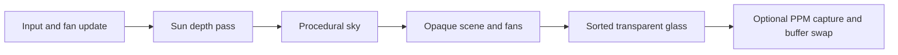

# KUET Student Welfare Centre - Interactive 3D OpenGL Project

A C++17/OpenGL 3.3 architectural visualization of KUET's Student Welfare
Centre (SWC), modeled from the 30 reference photographs in `project/`.

Quick links: [Build and run](#build-and-run-powershell) ·
[Controls](#camera-controls) · [Folder layout](#folder-layout) ·
[Features and equations](#implemented-features-and-mathematics) ·
[Validation](#validation).


**Main entrance — capture 1.** Boxes, cylinders, curved surfaces, and repeated
components form the building and grounds. Procedural materials supply the brick
and paving detail; directional lighting and shadow mapping give the forms depth.
The images in this README are captures from the application, stored in
`docs/images/` so they remain available independently of the generated `build/` folder.

The layout follows `SWC_Reference.txt`: connected wings of differing heights
around a large courtyard lawn, the deep front portico and long colonnade, the
flared curved brick SWC facade with bands, louvers and bilingual lettering,
the courtyard stage, the cafeteria with its external stair, the plaza alpona,
the bamboo gazebo, roads, hedges and palms. Lighting is per-fragment Phong
with shadow mapping from one consistent sun.

The corrected layout leaves the left side open. Behind the entrance and curved
SWC sign, a covered tiled corridor connects to the three-storey block, with
aligned upper walkways and return stairs serving all three floors. The central
entrance doorway is open so the route through to the courtyard is visible.
The three-storey block is shifted forward and onto the doorway's centreline:
walking through the main door now continues straight along its corridor.
Its room side extends to the right edge of the oval SWC facade, with additional
front window bays; the corridor and stair alignment stays fixed.
The cafeteria occupies the rear bays beside the gazebo, at a setback of 20
units from the old side entrance. Facing it, the external stair is on the
right and joins a separate two-storey balcony/windowed block. Camera preset
`5` faces the entrance and `V` shows the complete corner.

The 14 additional photographs in `project_2/` guide the right-side shop wing:
a two-storey shop canopy extends back from the curved sign,
with tall free-standing columns, a recessed plain upper wall, open
shops and brick-inset end balconies. Farther back, the cafeteria's right-hand
stair connects to the grilled balcony of its adjoining low block. The roadside
planting, raised tiled arcade, and paved forecourt follow the new views.
Dimensions remain visual estimates from photographs, rather than a survey.

Covered tiled passages connect the compact stall wing, front entrance and
courtyard. Two wide stalls sit left of the grille entrance; its steps and paved
approach lead straight through the room block to the courtyard corridor.
The entrance's open upper balcony, brick parapet, grille and adjacent window
wall follow `project_2/WhatsApp Image 2026-09-29 at 6.42.32 PM.jpeg`.
Press `H` to view the entrance and straight passage.

## Build and run (PowerShell)

```powershell
cd D:\image_project
cmake -S . -B build -G "MinGW Makefiles"
cmake --build build --parallel
.\build\image_project.exe
```

The current executable is `build/image_project.exe`. Close the viewer before
rebuilding so Windows can replace it.

The first CMake configuration downloads GLFW. Later builds normally work
offline. The program opens at a front three-quarter presentation view.

## VS Code include paths

Open `D:\image_project` as the workspace folder. The checked-in
`.vscode/c_cpp_properties.json` configures IntelliSense for the installed
32-bit MinGW compiler at `C:/MinGW/bin/g++.exe`, C++17, and the project/GLFW
headers. CMake generates `build/compile_commands.json` so source files use
their actual build flags; explicit include paths also cover standalone headers.
See the [VS Code IntelliSense documentation](https://code.visualstudio.com/docs/cpp/configure-intellisense).

After a fresh checkout, run the CMake configure command above to fetch GLFW
and generate the compilation database. If stale include errors remain, run
**C/C++: Reset IntelliSense Database** and **Developer: Reload Window** from
the command palette. If you change compiler installations, update
`compilerPath` and `intelliSenseMode` in the configuration accordingly.

## Camera controls

The orbit controls below apply outside walking mode. Press `F6` to switch to
walking, where `WASD` moves the camera and arrow keys change its viewing direction.

| Control | Action |
|---|---|
| `1` - `9` | Reference-photo views (see below) |
| `0` | Right-side shops and curved-wall connection |
| `V` | Right-side balcony, external stair, and cafeteria forecourt |
| `H` | Covered corridor behind the oval facade |
| `F1` - `F5` | Orthographic front / back / left / right / top (plan) views |
| `F6` | Enter / leave collision-aware walking mode |
| `F7` / `F8` | Room interior / glass entrance views |
| `F9` | Enter / leave the basic-object gallery |
| `P` | Pause / resume ceiling fans |
| Hold left mouse + drag | Orbit around the view target |
| Hold right mouse + drag | Pan the view target |
| Mouse wheel | Zoom in or out |
| `A` / `D` or Left / Right | Rotate horizontally |
| `W` / `S` or Up / Down | Rotate vertically |
| `Q` / `E` | Zoom out / in |
| `T` / `G` | Walk the target forward / back (hold Shift to go faster) |
| `Page Up` / `Page Down` | Raise / lower the target |
| `R` | Return to the main entrance view |
| `F` | Main entrance view and reset model transform |
| `B` | Toggle shadows |
| `J` / `L` | Rotate the 3D model |
| `Z` / `X` | Scale the 3D model down / up |
| `U` / `O` | Translate the 3D model left / right |
| `I` / `K` | Translate the 3D model away / toward the camera |
| `C` | Reset model translation, rotation, and scale |
| `Esc` | Close the program |

| Key | View | Reference photo |
|---|---|---|
| `1` | Main entrance | 3.08.02 AM |
| `2` | Curved SWC facade | 3.08.02 AM (1) |
| `3` | Front-left colonnade | 3.08.01 AM (1) |
| `4` | Front-right wide view | 3.08.04 AM |
| `5` | Cafeteria entrance | 3.07.55 AM |
| `6` | Courtyard stage | 3.07.59 AM |
| `7` | Open left courtyard lawn | Corrected site layout |
| `8` | Straight view through entrance door into the three-storey corridor | Corrected alignment |
| `9` | Aerial overview | - |
| `0` | Right-side shops | project_2, 6.42.27-6.42.31 PM |
| `V` | Right-side stair and balcony | project_2, 6.42.34 PM |
| `H` | Covered connecting corridor | project_2, 6.42.32 PM |
| `F1` | Front elevation (orthographic) | All 44 photos |
| `F2` | Back elevation (orthographic) | All 44 photos |
| `F3` | Left elevation (orthographic) | All 44 photos |
| `F4` | Right elevation (orthographic) | All 44 photos |
| `F5` | Top view / plan, front at the bottom (orthographic) | All 44 photos |

`image_project.exe --capture <1-21> out.ppm` renders one view in a hidden window
and exits. Capture `10` is the `0` key view; capture `11` is the `V` key view.
Capture `12` is the `H` key view. Captures `13`-`17` are the `F1`-`F5`
orthographic views. An optional size can follow the file name:

```powershell
.\build\image_project.exe --capture 13 front.ppm 2200 600   # front elevation
.\build\image_project.exe --capture 17 top.ppm 1600 1600    # top view
```

Rendered front, back, left, right and top views are in `build/views/`, with
all five on one sheet in `build/views/SWC_all_views.png`.

## Scene structure


**Site assembly — capture 9.** This perspective view shows how the separate
building wings, open courtyard, paths, and planting fit together. The scene
modules create these parts in local coordinates, and the transform stack places
them into one shared coordinate system. See [composite transformations](#3-translation-rotation-scaling-and-hierarchy)
for the placement equations.

Reusable canonical base shapes are in `src/geometry/canonical_shapes.h`, with
shared vector/matrix math in `src/geometry/geometry_math.h`. See
[CANONICAL_SHAPES.md](CANONICAL_SHAPES.md) for dimensions, transformations,
copyable usage examples and optional geometry tests. Existing scene helpers
use these bases while preserving the model's original vertex data and view.

`buildScene()` in `src/scene/scene.cpp` assembles the model from reusable components
placed with composite `T * R * S` transforms on a transform stack (`Place`):

- `windowBay`, `acUnit`, `door`, `balconyPanel`, `openFrame`, `stair`
- `windowedWing` (long windowed wings) and `galleryWing` (balcony corridors)
- `curvedBrickFacade`, `frontWing`, `entranceCorridor`, `connectedStairwell`,
  `courtyard`, `stage`, `rightSideWing`, `frontGapCorridor`, `cafeteria`, `cafeteriaRightBlock`
- `broadleafTree`, `coconutPalm`, `fanPalm`, `arecaPalm`, `araucaria`,
  `shrub`, `croton`, `hedge`, `gazebo`, `alpona`

Wing lengths, bay counts, storey heights and the curved wall's radius, arc,
flare and heights are parameters, so they can be refined against the photos.

## Folder layout

```text
image_project/
|-- CMakeLists.txt
|-- include/gl_loader.h
|-- include/room_navigation.h
|-- include/walk_navigation.h
|-- src/geometry/canonical_shapes.h
|-- src/geometry/geometry_math.h
|-- src/gl_loader.c
|-- src/main.cpp         entry point only
|-- src/app/             command-line options and application startup
|-- src/geometry/        mesh primitives and transform stack
|-- src/scene/           materials, layout, buildings, rooms, landscape, scene assembly
|-- src/input/           camera presets, keyboard and mouse controls
|-- src/navigation/      scene collision setup and walk-route checks
|-- src/render/          OpenGL rendering, shaders and screenshot output
|-- tests/               geometry and navigation tests
|-- docs/images/         project screenshots used in this README
|-- project/             30 reference photographs
|-- project_2/           14 additional right-side photographs
`-- build/               generated files and executable
```

Most modules have a `.h` interface and a separately compiled `.cpp` implementation.
The canonical shape generators and geometry math are header-only utilities.
`src/scene/layout.h` owns the shared building dimensions. Within `src/scene/`,
`front.cpp`, `courtyard.cpp`, and `exterior.cpp` build the architectural sections;
`components.cpp` supplies reusable building parts, `lettering.cpp` builds signs,
`site.cpp` builds the grounds, `landscape.cpp` places vegetation and the gazebo,
and `rooms.cpp` and `base_objects.cpp` build interiors and the object gallery.
`scene.cpp` keeps their original assembly order. The build/run commands and
controls are unchanged.

## Everyday workflow

1. Edit the relevant module under `src/`; scene assembly starts in `src/scene/scene.cpp`.
2. Run `cmake --build build --parallel`.
3. Run `.\build\image_project.exe`.

The photographs remain in `project/` for visual comparison. They are reference
inputs; the executable does not need to load them at runtime.

## Walk-through rooms


**Interior geometry — capture 19 / F7.** The room combines box-based furniture,
window frames, and cylindrical fan parts. The fan mount stays fixed while the
rotor receives its own animated transform. Walking collision uses the static
room geometry; see [fan animation](#10-time-based-ceiling-fan-animation) and
[walking and collision](#11-walking-collision-detection-and-stairs) for the equations.

Three furnished rooms open onto the straight connecting corridor. Each has a
parked-open sliding door, transparent Thai-style aluminium-framed glazing and
a rotating ceiling fan. These interiors are illustrative additions.

Run `.\build\image_project.exe`, then press **F6** to walk around the SWC.
Walking starts at the current view when it is on an accessible floor; aerial
and gallery views start at the front plaza instead.
Use **WASD** to walk and **arrow keys** or **left-mouse drag** to look around.
Hold **Shift** to walk faster.
Walls, glass and furniture stop movement; enter through the central opening.
**F6** or **R** returns to the main exterior view. Walk across the grounds,
through the open entrance into the courtyard and connecting corridors, and
through the glass doorways into the three furnished rooms. Steps change your
eye height automatically; walls, closed doors, glass, railings and low ceilings
block movement. Only existing open interiors are accessible: solid building
masses are not furnished rooms.

**F7** shows a room and fan; **F8** looks back through the glass entrance.
**P** pauses/resumes all fans. Existing exterior and orthographic presets remain
available outside walking mode. Capture views **18**, **19**, **20** are the
corridor, room interior and glass entrance; captures use a fixed fan angle.

Reusable `room`, `thaiGlassPanel` and `ceilingFanMount` functions are in
`src/scene/rooms.cpp`. Room dimensions and fan transforms are in `include/room_navigation.h`.
`include/walk_navigation.h` indexes the rendered scene triangles for body
clearance, floor support, wall sliding and stair movement. Fan rotors reuse one mesh with animated transforms;
glass is blended after opaque geometry. Build with `SWC_BUILD_TESTS=ON` and run
`ctest --test-dir build --output-on-failure` to check geometry, movement and complete SWC routes.
`image_project.exe --check-walk` runs the scene route checks without a window.

## Base object gallery


**Basic geometry — capture 21 / F9.** Each displayed object starts from the
canonical generators in `src/geometry/canonical_shapes.h`. The gallery places
and scales them on individual bases, demonstrating how simple triangle meshes
can be reused throughout the larger model. Their construction equations appear
under [basic objects and triangle meshes](#1-basic-objects-and-triangle-meshes).

Press **F9** to inspect the cube, cylinder, sphere, cone, frustum, open tube,
ring, plane and triangle in a separate labelled gallery. Use **A/D** to orbit,
**W/S** to tilt, and **Q/E** to zoom (mouse drag and wheel also work).
Press **F9** again or **R** to return to the building. Capture view **21** exports
the gallery. `buildBaseObjectGallery()` demonstrates the canonical generators
with placement and scaling; the SWC geometry stays in its own draw range.

## Courtyard reference view


**Repeated architectural components — capture 6.** The window and balcony bays
repeat reusable geometry across the facade. The lawn, brick, and daylight sky
use procedural shading, while the stage and surrounding building cast shadows.
This view connects the [material equations](#8-procedural-materials-sky-and-fog)
with the [lighting](#6-per-fragment-phong-illumination) and
[shadow calculations](#7-shadow-mapping-and-filtering).

Press **6** for the courtyard and stage matched to
`project/WhatsApp Image 2026-09-26 at 3.07.59 AM.jpeg`.
The north wing has four projecting framed bays and three open balcony bays,
a wider footprint, recessed brick panels, narrow ground-floor windows and a
low, shallow curved stage. The lawn is kept open in front of the stage.
The daylight sky and lawn use procedural shading; no external textures are needed.
Dimensions are estimated from the photograph rather than surveyed measurements.

For a preview in the photograph's 4:3 aspect ratio:

```powershell
.\build\image_project.exe --capture 6 build/stage-reference.ppm 1200 900
```

## Implemented features and mathematics

The equations below describe the current implementation. Positions use approximate
metres, with **+Y upward**, **+X to the right when facing the entrance**, and
**+Z toward the front plaza**. Angles in equations are radians unless marked as
degrees. Matrices below multiply column vectors; the C++ arrays store matrices
in column-major order. The application builds its own geometry and math rather
than loading a finished 3D model.

| Feature | Purpose in this project | Implementation |
|---|---|---|
| Basic geometric objects | Construct buildings, furniture, trees, and the F9 gallery | [canonical_shapes.h](src/geometry/canonical_shapes.h), [mesh.cpp](src/geometry/mesh.cpp) |
| Vector and matrix operations | Calculate positions, directions, normals, and projections | [geometry_math.h](src/geometry/geometry_math.h) |
| Composite transformations | Place, rotate, and scale reusable objects and the complete model | [mesh.h](src/geometry/mesh.h), [renderer.cpp](src/render/renderer.cpp) |
| Reusable scene components | Assemble windows, corridors, wings, rooms, and landscaping | [scene.cpp](src/scene/scene.cpp), [components.cpp](src/scene/components.cpp) |
| Camera and projections | Orbit, pan, zoom, walk, and inspect elevations | [camera.cpp](src/input/camera.cpp), [geometry_math.h](src/geometry/geometry_math.h) |
| Phong illumination | Shade surfaces using ambient, diffuse, and specular terms | [shaders.cpp](src/render/shaders.cpp) |
| Shadow mapping | Cast building, tree, and animated fan shadows | [renderer.cpp](src/render/renderer.cpp), [shaders.cpp](src/render/shaders.cpp) |
| Procedural surfaces and sky | Produce brick, paving, grass, thatch, and clouds without image textures | [materials.cpp](src/scene/materials.cpp), [shaders.cpp](src/render/shaders.cpp) |
| Transparent glass | Show room interiors through glazing | [rooms.cpp](src/scene/rooms.cpp), [renderer.cpp](src/render/renderer.cpp) |
| Animation | Rotate the three ceiling fans using elapsed time | [room_navigation.h](include/room_navigation.h), [renderer.cpp](src/render/renderer.cpp) |
| Collision and stairs | Keep the walking camera on floors and out of solid geometry | [walk_navigation.h](include/walk_navigation.h), [navigation.cpp](src/navigation/navigation.cpp) |
| GPU rendering and capture | Draw triangle meshes, test depth, and export PPM images | [renderer.cpp](src/render/renderer.cpp), [screenshot.cpp](src/render/screenshot.cpp) |

### 1. Basic objects and triangle meshes

`canonical_shapes.h` defines reusable objects around a standard origin. The
functions in `mesh.cpp` turn them into positioned scene geometry. Each vertex
stores a position, normal, colour, gloss value, and procedural-pattern identifier.
Three consecutive vertices form a triangle; a quad becomes two triangles:

$$
(A,B,C,D)\longrightarrow(A,B,C),\;(A,C,D).
$$

**Cube and box.** The canonical cube has coordinates between $-0.5$ and $0.5$
on each axis. A box with centre $(c_x,c_y,c_z)$ and dimensions $(w,h,d)$ uses:

$$
x=c_x\pm\frac{w}{2},\qquad
y=c_y\pm\frac{h}{2},\qquad
z=c_z\pm\frac{d}{2}.
$$

Six faces give twelve triangles. Boxes form walls, floors, beams, doors, and furniture.

**Cylinder and open tube.** Circular geometry samples angles
$\theta_i=2\pi i/N$, where $N$ is the number of segments. An elliptical cylinder uses:

$$
\mathbf p(\theta,y)=
\begin{bmatrix}c_x+r_x\cos\theta\\y\\c_z+r_z\sin\theta\end{bmatrix},
\qquad y\in[c_y-h/2,c_y+h/2].
$$

The canonical cylinder has radius 1, height 1, and both end caps. The canonical
tube has radius 1, runs from $y=0$ to $y=1$, and has no caps. Cylindrical forms
are used for columns, poles, fan parts, and vegetation.

**Cone and frustum.** Radius varies linearly with height:

$$
r(t)=(1-t)r_0+tr_1,\qquad
\mathbf p(\theta,t)=\mathbf b+
\begin{bmatrix}r(t)\cos\theta\\ht\\r(t)\sin\theta\end{bmatrix},
\quad 0\le t\le1.
$$

Here $\mathbf b$ is the base centre, $h$ is height, and $r_0,r_1$ are bottom
and top radii. A cone uses $r_1=0$. The side normal is proportional to
$(\cos\theta,(r_0-r_1)/h,\sin\theta)$. The canonical generator supports caps;
the scene's `frustum()` adapter preserves its open bottom and top cap.

**Sphere and ellipsoid.** With latitude $\phi$ and longitude $\theta$:

$$
\mathbf p(\phi,\theta)=\mathbf c+r
\begin{bmatrix}
\cos\phi\cos\theta\\\sin\phi\\\cos\phi\sin\theta
\end{bmatrix},
\qquad -\pi/2\le\phi\le\pi/2,\quad 0\le\theta<2\pi.
$$

Latitude/longitude cells are triangulated. Scaling the three coordinates by
different radii produces an ellipsoid, used for foliage and rounded forms.

**Ring, plane, and triangle.** An annulus lies in the XZ plane:

$$
\mathbf p(r,\theta)=(c_x+r\cos\theta,\;c_y,\;c_z+r\sin\theta),
\qquad r_{\mathrm{inner}}\le r\le r_{\mathrm{outer}}.
$$

Angular sectors form the ring; limiting the angle produces an arc. The canonical
plane is a unit square at $y=0$, and the canonical triangle has vertices
$(0,0,0)$, $(1,0,0)$, and $(0,1,0)$. These nine object types are demonstrated
in [base_objects.cpp](src/scene/base_objects.cpp), available with `F9`.

**Stairs and repeated components.** `stair()` builds each tread as a box. For
step index $i=0,\ldots,N-1$, riser height $h_r$, tread depth $d_t$, and front
coordinate $z_f$, its top and depth interval are:

$$
y_i=y_{\mathrm{base}}+(i+1)h_r,\qquad
z\in[z_f-(i+1)d_t,\;z_f-id_t].
$$

Repeated windows, columns, and floor levels use loops and local transforms.
[lettering.cpp](src/scene/lettering.cpp) builds signs from 5-by-5 block glyphs;
the Bengali line uses stylized generated strokes rather than a font renderer.
[site.cpp](src/scene/site.cpp) combines rings and petal geometry for the plaza artwork.

### 2. Vector operations and surface normals

For vectors $\mathbf a$ and $\mathbf b$, the custom math library implements:

$$
\mathbf a\cdot\mathbf b=a_xb_x+a_yb_y+a_zb_z,\qquad
\|\mathbf a\|=\sqrt{\mathbf a\cdot\mathbf a},\qquad
\hat{\mathbf a}=\frac{\mathbf a}{\|\mathbf a\|}.
$$

$$
\mathbf a\times\mathbf b=
\begin{bmatrix}a_yb_z-a_zb_y\\a_zb_x-a_xb_z\\a_xb_y-a_yb_x\end{bmatrix},
\qquad
\mathbf n=\operatorname{normalize}((B-A)\times(C-A)).
$$

The dot product measures directional alignment for lighting; the cross product
constructs face normals and camera axes. `normalize()` returns $(0,1,0)$ when
the input length is too small to divide safely. Smooth shapes supply their own
per-vertex normals rather than a single flat normal per triangle.

Matrix multiplication is implemented directly with three nested loops:

$$
(AB)_{ij}=\sum_{k=0}^{3}A_{ik}B_{kj},\qquad i,j\in\{0,1,2,3\}.
$$

### 3. Translation, rotation, scaling, and hierarchy

A point is represented in homogeneous coordinates as $\mathbf p=(x,y,z,1)^T$.
The project uses these translation, Y-rotation, and scale matrices:

$$
T=\begin{bmatrix}1&0&0&t_x\\0&1&0&t_y\\0&0&1&t_z\\0&0&0&1\end{bmatrix},
\quad
R_y(\theta)=\begin{bmatrix}
\cos\theta&0&\sin\theta&0\\0&1&0&0\\-\sin\theta&0&\cos\theta&0\\0&0&0&1
\end{bmatrix},
\quad
S=\begin{bmatrix}s_x&0&0&0\\0&s_y&0&0\\0&0&s_z&0\\0&0&0&1\end{bmatrix}.
$$

`rotationX()` also rotates geometry around X:

$$
R_x(\theta)=\begin{bmatrix}
1&0&0&0\\0&\cos\theta&-\sin\theta&0\\0&\sin\theta&\cos\theta&0\\0&0&0&1
\end{bmatrix}.
$$

`trs()` combines transformations as:

$$
M_{\mathrm{local}}=TR_yS,\qquad
M_{\mathrm{child}}=M_{\mathrm{parent}}M_{\mathrm{local}}.
$$

The rightmost operation happens first: scale, rotate, then translate. `Place`
pushes the child transform onto a stack and restores the parent when its scope
ends. A window can therefore be built in local coordinates and placed on a
rotated building wing. These placement transforms are baked into mesh vertices;
the renderer applies a separate interactive model transform to the assembled scene.

Non-uniform scaling requires an inverse-transpose normal matrix. For the upper
left $3\times3$ part $A$ of a model transform:

$$
\mathbf n'=\operatorname{normalize}\left((A^{-1})^T\mathbf n\right).
$$

This keeps lighting normals perpendicular to surfaces after scaling.

### 4. Orbit camera, look-at matrix, and zoom

The orbit camera uses target $\mathbf c$, distance $d$, yaw $\psi$, and pitch
$\phi$. Its eye position is:

$$
\mathbf e=\mathbf c+d
\begin{bmatrix}\cos\phi\sin\psi\\\sin\phi\\\cos\phi\cos\psi\end{bmatrix}.
$$

`lookAt()` builds a camera basis from a supplied up direction $\mathbf u_0$:

$$
\mathbf f=\operatorname{normalize}(\mathbf c-\mathbf e),\quad
\mathbf s=\operatorname{normalize}(\mathbf f\times\mathbf u_0),\quad
\mathbf u=\mathbf s\times\mathbf f.
$$

$$
V=\begin{bmatrix}
s_x&s_y&s_z&-\mathbf s\cdot\mathbf e\\
u_x&u_y&u_z&-\mathbf u\cdot\mathbf e\\
-f_x&-f_y&-f_z&\mathbf f\cdot\mathbf e\\
0&0&0&1
\end{bmatrix}.
$$

Dragging changes yaw/pitch; panning moves the target along camera-relative
horizontal directions. A mouse-wheel offset $\delta$ updates zoom using
$d'=\operatorname{clamp}(d\,0.9^{\delta},0.5,160)$.
Preset views select the eye, target, field of view, and optional orthographic size.

### 5. Perspective and orthographic projection


**Plan projection — capture 17 / F5.** The camera looks straight down, with the
front of the site at the bottom. Orthographic projection keeps the scale
independent of camera depth, making the arrangement easier to inspect. Compare
this with the aerial perspective image in [Scene structure](#scene-structure),
where distance affects apparent size. The two views use different camera poses.

For vertical field of view $\alpha$, aspect ratio $a$, near distance $n$, far
distance $f$, and $q=1/\tan(\alpha/2)$, perspective projection is:

$$
P=\begin{bmatrix}
q/a&0&0&0\\0&q&0&0\\
0&0&-(f+n)/(f-n)&-2fn/(f-n)\\0&0&-1&0
\end{bmatrix}.
$$

Objects appear smaller with distance after the perspective division. Elevation
and plan views use orthographic bounds $l,r,b,t$ instead:

$$
P_{\mathrm{ortho}}=\begin{bmatrix}
2/(r-l)&0&0&-(r+l)/(r-l)\\
0&2/(t-b)&0&-(t+b)/(t-b)\\
0&0&-2/(f-n)&-(f+n)/(f-n)\\
0&0&0&1
\end{bmatrix}.
$$

The complete camera transform is:

$$
\mathbf p_{\mathrm{clip}}=PVM\mathbf p,\qquad
\mathbf p_{\mathrm{ndc}}=
\frac{(p_{\mathrm{clip},x},p_{\mathrm{clip},y},p_{\mathrm{clip},z})}
{p_{\mathrm{clip},w}}.
$$

Here $M$ is the interactive model transform applied to the already assembled
mesh. The camera uses near/far distances of 0.15 and 450. The sun's shadow
camera uses its own orthographic projection.

### 6. Per-fragment Phong illumination

The fragment shader normalizes interpolated normals and computes lighting per
pixel. Let $\mathbf n$ be the surface normal, $\mathbf l$ the normalized direction
toward the sun, $\mathbf v$ the direction toward the eye, $g$ the material gloss,
and $S_h$ the shadow visibility between 0 and 1. The shader uses:

$$
D=\max(\mathbf n\cdot\mathbf l,0)S_h,\qquad
\mathbf r=2(\mathbf n\cdot\mathbf l)\mathbf n-\mathbf l,
$$

$$
k=8+88g,\qquad
H=\max(\mathbf v\cdot\mathbf r,0)^k\,gS_h.
$$

The ambient colour blends ground bounce and sky illumination based on normal Y:

$$
\mathbf A=0.62\operatorname{mix}
(\mathbf C_{\mathrm{ground}},\mathbf C_{\mathrm{sky}},0.5n_y+0.5).
$$

For ordinary materials, the colour before glass, fog, and highlight adjustments is:

$$
\mathbf C=\mathbf C_{\mathrm{base}}\odot
(\mathbf A+0.95\mathbf C_{\mathrm{sun}}D)
+0.6\mathbf C_{\mathrm{sun}}H.
$$

$\odot$ means component-wise colour multiplication. Higher gloss produces a
narrower, stronger highlight. Interior-pattern materials use a separate brighter
ambient treatment. Normals facing away from the viewer are flipped for two-sided
leaves, glass, and thin panels.

### 7. Shadow mapping and filtering

The renderer first draws a depth map from the sun's viewpoint, at **4096 x 4096**.
For a world-space surface point $\mathbf p$, the receiving shader offsets along
the transformed vertex normal and projects into light space:

$$
\mathbf p_L=P_LV_L
\begin{bmatrix}\mathbf p+0.05\hat{\mathbf n}\\1\end{bmatrix},\qquad
\mathbf q=0.5\frac{\mathbf p_{L,xyz}}{p_{L,w}}+0.5.
$$

The depth comparison uses a slope-dependent bias to reduce self-shadow artifacts:

$$
\beta=0.0006+0.0012\left(1-\max(\mathbf n\cdot\mathbf l,0)\right).
$$

Nine neighbouring samples produce a 3-by-3 percentage-closer filter (PCF):

$$
S_h=\frac{1}{9}\sum_{i=-1}^{1}\sum_{j=-1}^{1}
\mathbf 1\left[q_z-\beta\le
D_{\mathrm{map}}(q_x+i/4096,q_y+j/4096)\right].
$$

$\mathbf 1$ is 1 when the comparison is true and 0 otherwise. Averaging softens
shadow edges. `B` toggles shadows in orbit mode; fan geometry participates in
both the shadow pass and the visible pass.

### 8. Procedural materials, sky, and fog

Surface colours come from world-position calculations, not external texture
images. Brick, paving, and tiles use repeated cells; alternating brick rows shift
by half a unit:

$$
j=\lfloor v/h\rfloor,\qquad
\mathbf c=\left(u/w+0.5(j\bmod2),\;v/h\right).
$$

Here $w,h$ are a unit's width/height and $(u,v)$ are surface coordinates. The
fractional part of $\mathbf c$ locates mortar edges. Hashed cell values vary
colour, while screen-space derivatives fade fine patterns when they become
too small to display clearly.

Value noise interpolates four hashed grid corners using the smooth weight:

$$
w(t)=t^2(3-2t),\qquad
\operatorname{mix}(A,B,t)=(1-t)A+tB.
$$

Noise at different scales supplies grass patches, blades, natural surfaces,
and thatch. The CPU also uses deterministic `hash1()` values to vary vegetation
and window materials without changing the arrangement on every frame.

The sky shader constructs a view ray from screen coordinates $(s_x,s_y)$:

$$
\mathbf d=\operatorname{normalize}\left(
\mathbf f+\mathbf s\,s_xa\tan(\alpha/2)
+\mathbf u\,s_y\tan(\alpha/2)\right).
$$

It blends horizon and upper-sky colours by ray elevation. Cloud density combines
five noise layers, with $\mathbf p_0$ the projected sky coordinate:

$$
C_{\mathrm{cloud}}=\sum_{i=0}^{4}0.55(0.48)^iN(\mathbf p_i),\qquad
\mathbf p_{i+1}=2.03\mathbf p_i+(3.7,1.8).
$$

Distance fog blends surface colour toward a pale blue fog colour:

$$
F=1-e^{-0.006\max(d-45,0)},\qquad
\mathbf C_{\mathrm{fogged}}=(1-0.65F)\mathbf C+0.65F\mathbf C_{\mathrm{fog}}.
$$

Here $d$ is the eye-to-surface distance. Orthographic views also soften colour
components above 0.78 using $0.78+0.22(1-e^{-(c-0.78)/0.22})$ before fog is applied.

### 9. Glass transparency and reflection approximation


**Transparent glazing — capture 20 / F8.** The glass is drawn after opaque
objects so the scene behind it contributes to the final colour. The metal
frames remain opaque. The equations below explain the alpha blend and the
view-dependent sky/ground reflection approximation used for the panes.

Room glass uses alpha $\alpha_g=0.20$. After opaque objects, panes are sorted
from farthest to nearest by their transformed centre's distance to the eye.
Depth testing stays active, but depth writing is disabled while blending:

$$
\mathbf C_{\mathrm{out}}=\alpha_g\mathbf C_{\mathrm{glass}}
+(1-\alpha_g)\mathbf C_{\mathrm{behind}}.
$$

Glass materials also use a view-angle-dependent reflection approximation:

$$
F_g=0.08+0.62\left(1-\max(\mathbf n\cdot\mathbf v,0)\right)^3,\qquad
\mathbf C'=\operatorname{mix}(\mathbf C,\mathbf C_{\mathrm{environment}},0.35F_g).
$$

The environment colour is estimated from sky and ground colours. This is a
stylized Fresnel-like effect, not physical refraction or a ray-traced reflection.
The separate opaque-glass pattern has the reflection effect but alpha 1.

### 10. Time-based ceiling-fan animation

The renderer measures elapsed time and limits each update to 0.05 seconds:

$$
\Delta t=\min(t_{\mathrm{now}}-t_{\mathrm{previous}},0.05),\qquad
\theta_{\mathrm{new}}=
(\theta_{\mathrm{old}}+\omega\Delta t)\bmod2\pi,\qquad
\omega=240\pi/180\ \text{rad/s}.
$$

For each room centre $x$, the same rotor mesh is drawn using:

$$
M_{\mathrm{fan}}=M_{\mathrm{scene}}T(x,3.13,-23.55)R_y(\theta).
$$

This reuses one rotor mesh at three locations through separate draw calls.
`P` pauses/resumes the updates. Capture mode keeps a fixed fan angle for
repeatable screenshots. The time cap limits sudden jumps after a long frame.

### 11. Walking, collision detection, and stairs

Collision triangles are built from the same static scene geometry that is drawn.
The animated rotors and separate gallery are excluded. A spatial grid with
2-metre cells reduces the triangles examined near the player:

$$
(i,j)=\left(\left\lfloor x/2\right\rfloor,
\left\lfloor z/2\right\rfloor\right).
$$

Walking uses a body radius of 0.18, body height of 1.78, eye height of 1.6, and
maximum step-up height of 0.24. Given forward input $f$, sideways input $r$,
and camera yaw $\psi$, the desired direction is:

$$
\mathbf d=(r\cos\psi-f\sin\psi,\;0,\;-r\sin\psi-f\cos\psi),\qquad
\Delta\mathbf p=\frac{\mathbf d}{\|\mathbf d\|}v\Delta t.
$$

The displacement is zero when there is no input. Speed $v$ is 2.4 metres/second,
or 4.2 with Shift. Normalization prevents diagonal movement from being faster.
Movement is divided into substeps no longer than 0.06:

$$
N=\max\left(1,\left\lceil\|\Delta\mathbf p\|/0.06\right\rceil\right),\qquad
\mathbf s=\Delta\mathbf p/N.
$$

Floor height is found by solving the triangle's XZ barycentric coordinates:

$$
\begin{bmatrix}B_x-A_x&C_x-A_x\\B_z-A_z&C_z-A_z\end{bmatrix}
\begin{bmatrix}u\\v\end{bmatrix}
=\begin{bmatrix}x-A_x\\z-A_z\end{bmatrix},\qquad
y=A_y+u(B_y-A_y)+v(C_y-A_y).
$$

A point is inside when $u\ge0$, $v\ge0$, and $u+v\le1$, with small numerical
tolerances in the code. The highest reachable support is sampled at the foot
centre and eight points around its edge. Floor candidates have normal Y above
0.65; support may rise by 0.24 or fall by up to 0.65 per substep, with a small
step-up tolerance.

Obstacle triangles are clipped to the body's vertical interval, then projected
into XZ. For an edge $AB$ and foot centre $P$, the closest edge point is:

$$
t=\operatorname{clamp}\left(\frac{(P-A)\cdot(B-A)}{\|B-A\|^2},0,1\right),
\qquad Q=A+t(B-A).
$$

An edge distance below the body radius, or a centre inside the clipped polygon,
blocks movement. If a combined XZ move fails, separate X and Z moves are tried
to allow sliding along walls. Unsupported moves are rejected; there is no
gravity simulation or jumping. Walking resets the interactive scene transform
so the camera and collision geometry use the same coordinates.

### 12. Rendering passes, depth, and screenshots

The CPU uploads the mesh once to a vertex buffer; a vertex array describes its
attributes. Each frame follows this order:



The shadow pass is skipped when shadows are disabled. The sky pass is skipped
for orthographic views and the object gallery. Opaque geometry uses depth testing
and depth writes so nearer fragments hide farther fragments. The window requests
4-sample multisampling to smooth geometry edges when supported by the graphics driver.

`--capture` opens a hidden OpenGL window, reads RGB pixels on the third rendered
frame, flips the bottom-up framebuffer row order, and saves a binary PPM file.
It still requires an OpenGL context. `--check-walk` runs collision-route checks
without creating a graphics window.

## Validation

The embedded screenshots use capture presets 1, 9, 6, 17, 19, 20, and 21.
To reproduce a view, use its caption's capture number, for example:

```powershell
.\build\image_project.exe --capture 21 build/basic-objects.ppm 1000 750
```

The application exports PPM. The README assets are lossless PNG conversions of
those captures; conversion changes the file format, not the rendered content.
Captures hold the fan angle fixed, so the room screenshots show a single
animation pose.

To build and run the existing geometry and navigation checks:

```powershell
cmake -S . -B build -G "MinGW Makefiles" -DSWC_BUILD_TESTS=ON
cmake --build build --parallel
ctest --test-dir build --output-on-failure
```

The three registered checks cover canonical shapes, room navigation, and routes
through the complete SWC scene. Screenshot captures provide a separate way to
compare visual output; the automated geometry/navigation tests do not check pixels.
